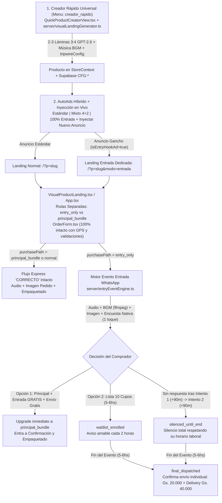

# Arquitectura Oficial: Creador Rápido Universal de Páginas Visuales, Embudo de Oferta de Entrada (`?modo=entrada`), AutoAds Híbrido y Evento WhatsApp con Encuesta Nativa + Música de Fondo

> **Nota de nomenclatura y confidencialidad comercial:** En toda la cara pública hacia el comprador (páginas de producto, URL `?modo=entrada`, anuncios de Meta, comentarios públicos, encuestas nativas y notas de voz de WhatsApp) está **estrictamente prohibido** pronunciar o mostrar la palabra técnica interna `"tripwire"`. Para el cliente siempre se presenta como una **Oferta de Entrada Especial** o **Artículo Complementario**. En el código interno (`src/types.ts`) se conserva únicamente en propiedades internas (`tripwireConfig`, `tripwireEventState`) por compatibilidad de esquema.

---

## 1. Propósito, Qué, Por Qué y Para Qué del Nuevo Algoritmo

El ecosistema original estaba acoplado a plantillas HTML rígidas y un embudo único de producto principal. Este nuevo algoritmo universal permite crear **cualquier tipo de producto** (Navidad, cocina, herramientas, bienestar, hogar, accesorios, etc.) en segundos y operar un **embudo de adquisición de doble ruta de alta rentabilidad**:

1. **Qué hace:** Permite subir la información esencial del producto principal y su producto complementario de entrada, genera **2 a 3 láminas gráficas verticales (`3:4`) de estudio comercial** usando **`openai/gpt-image-2.6-sunburst`** (orquestado con **`openai/gpt-4o`**) y despliega una página visual casi 100% gráfica —sin bloque HTML promocional inflado ni párrafos largos— intercalando únicamente **dos rutas de pedido estrictamente separadas** y la **pista musical de fondo preseleccionada** para WhatsApp.
2. **Por qué:** Un producto de entrada económico y congruente (`Gs. 10.000` – `Gs. 30.000`, p. ej. `Gs. 20.000`) dispara el **CTR** de Meta Ads y reduce drásticamente el costo por clic/lead, mientras la página visual sobria (con psicología inversa y sin gritar *"¡cómprame ya!"*) persuade con elegancia para escalar al producto principal o nutrir al comprador por WhatsApp.
3. **Para qué:**
   - Aumentar el CTR del conjunto de anuncios inyectando creatividades de **Oferta de Entrada** junto a anuncios **Estándar** (algoritmo Meta Andromeda).
   - Nunca enviar a pérdida un producto suelto de `Gs. 20.000` prometiendo envío gratis falso: si el comprador elige solo el producto de entrada, inicia un **evento automatizado de 5 a 6 horas por WhatsApp** (máximo **2 intentos** antes de silenciar hasta el cierre del evento) con **Audio + Música de Fondo + Encuesta Nativa de 1 toque** para escalarlo al paquete principal con el artículo complementario gratis y envío gratis — o, al finalizar la jornada laboral, confirmarle honestamente su envío individual sumando el **delivery (`Gs. 40.000`)**.

---

## 2. Arquitectura Completa de 4 Pilares Conectados

---

## 3. Pilar 1 — Comentarios Públicos Autónomos de Meta Ads (100% Público, Cero Messenger DM)

- **Archivos:** `server/metaCommentsEngine.ts`, `server/metaAuthSession.ts`, `src/components/MetaCommentsView.tsx`, `vite.config.ts`.
- **Por qué cero DM:** Messenger requiere verificación comercial adicional de Meta; todo el motor opera **100% por respuestas públicas** usando `pages_manage_engagement` + `pages_read_engagement` + `pages_show_list`.
- **Cómo funciona:**
  1. Poller continuo 24/7 (`syncMetaAdPostsAndComments`) que lee la jerarquía real **`Campaña → Conjunto de Anuncios → Anuncio`** (miniatura, copy, `adId`, `postId`) para responder contextualmente qué anuncio comentó el usuario.
  2. Si el cliente deja un número paraguayo (`09xx` / `+595`), `detectParaguayPhonesInText()` lo detecta, oculta el comentario público por seguridad (`is_hidden: true`), responde públicamente que por seguridad se resguardó su número y le deja enlace directo a su WhatsApp / Checkout Express.
  3. Respuestas **multi-ángulo** generadas en vivo por **OpenRouter (`openai/gpt-4o`)**: nunca usa textos enlatados ni fallbacks falsos.
  4. Interfaz en `MetaCommentsView.tsx` simplificada y 100% automática (sin bandejas de Messenger DM ni controles manuales confusos).

---

## 4. Pilar 2 — Creador Rápido Universal (`creador_rapido`) y Página Visual Sobria de 2–3 Láminas

- **Archivos:** `src/components/QuickProductCreatorView.tsx`, `src/components/ProductTemplateBuilderStudio.tsx`, `src/data/noeluxVisualPreset.ts`, `server/visualLandingGenerator.ts`, `src/components/VisualProductLanding.tsx`, `src/components/EntryHookLandingHero.tsx`, `src/views/AdminView.tsx`, `src/App.tsx`.
- **Dos Modos de Creación en el Mismo Creador (`pageCreationMode`):**
  1. **`Página Dual (Tripwire + Producto Ganador)` (`dual_tripwire_winner`):**
     - **Bloque 1 · Para Página Tripwire (Producto de Entrada):** nombre real visible al cliente, descripción completa, imagen propia o URL, precio promocional (`Gs. 20.000`), precio normal comparativo, delivery suelto (`Gs. 40.000`), cupos/horas y música de fondo.
     - **Bloque 2 · Para Página Producto Ganador (Misma Página · Ángulo Diferente):** nombre del Producto Ganador, campo específico **`winnerAngle`** (ángulo diferente dentro de la misma landing), descripción completa, imagen propia o URL, precio normal tachado + precios 1x/2x/3x y WhatsApp asignado.
  2. **`Exclusivamente Producto Principal` (`principal_only`):**
     - Oculta el bloque de entrada y construye una landing visual 100% enfocada en el Producto Principal con sus 2–3 láminas `GPT-2.6`, ángulo principal y packs directos con Envío Gratis (ideal para campañas estándar normales sin producto secundario). `StoreContext.addProductPage` respeta fielmente ambos modos sin forzar bloques extras en páginas `principal_only`.
- **Generación de láminas (`POST /api/products/quick-create-visual`):**
  1. Redacta con `openai/gpt-4o` los textos sobrios incluyendo **`winnerAngleHeadline`** y **`winnerAngleDescription`** para posicionar el Producto Ganador con un ángulo distinto dentro de la misma página, sin jerga ni promesas falsas de envío gratis en el artículo individual.
  2. Genera **2 a 3 láminas verticales (`3:4`)** mediante **`openai/gpt-image-2.6-sunburst`** (Héroe Visual Sobrio, Comparativa Principal vs. Complemento, y Bloque de Confianza/Uso) y las sube automáticamente a **Cloudinary** (`uploadImageToCloudinary`) con respaldo en `public/assets/visual-pages/`.
  3. Guarda la **música de fondo preseleccionada** (`backgroundMusicPreset`: `'warm_ambient' | 'soft_lounge' | 'commercial_pulse' | 'none'`) directamente dentro de `tripwireConfig`.
- **Página Visual con Dos Rutas y Fotos Reales Separadas (`VisualProductLanding.tsx`):**
  - **Ruta A (`entry_only`):** Muestra foto real, descripción y precio del artículo de entrada (`Gs. 20.000`), aclarando explícitamente que **NO incluye el producto principal** y que **NO cuenta con envío gratis**.
  - **Ruta B (`principal_bundle`):** Muestra foto real, el **ángulo diferente del Producto Ganador** (`winnerAngleHeadline` / `winnerAngleDescription`), packs 1x/2x/3x, **el artículo de entrada YA INCLUIDO de regalo** y **Envío Gratis a puerta**.
  - **`OrderForm.tsx` Intacto:** El formulario conserva **100%** de sus campos de Nombre, Celular, Departamento, Ciudad, Barrio/Dirección, Tipo de Vivienda (Casa/Edificio), Mapa GPS satelital y confirmación contra entrega sin alterar validaciones.

---

## 5. Pilar 3 — Campañas Estándar + Mixtas (`4 + 2`) + Inyección en Vivo + Ruta Dedicada `?modo=entrada`

- **Archivos:** `server/autoAdsIntelligence.ts`, `server/metaCampaignOps.ts`, `src/components/AutoAdsView.tsx`, `src/components/AutoAdsCampaignsPanel.tsx`, `src/utils/pipeboardEngine.ts`, `vite.config.ts`, `src/context/StoreContext.tsx`, `src/components/Navbar.tsx`.
- **Modos de Generación y Crecimiento Ilimitado (`+`):**
  - `100% Estándar`: arranca por defecto creando 100% anuncios normales del producto principal (flujo histórico intacto).
  - `Mixto (4 Estándar + 2 Gancho)`: combina en el lote inicial 4 anuncios estándar + 2 anuncios de Oferta de Entrada Congruente.
  - `100% Oferta de Entrada`: todo el lote inicial apunta al artículo de entrada.
  - **Toggle individual por tarjeta:** Cada tarjeta permite alternar `Estándar` | `Tripwire` (`isEntryHookAd`).
- **Botón `+` Ilimitado, Selector de Página Tripwire Destino y Enrutamiento Cruzado por Anuncio:**
  - Al crear o inyectar un anuncio Tripwire dentro de una campaña estándar (tanto en `AutoAdsView.tsx` — Bloque 1B, tarjetas individuales y tarjeta `+` — como en `AutoAdsCampaignsPanel.tsx` dentro de AdSets activos), el operador cuenta con un **selector explícito de Página Tripwire de Destino** (todas las páginas creadas con `tripwireConfig.enabled`) más acceso directo **`+ Crear Página Tripwire`** hacia `creador_rapido`.
  - **Visibilidad Total Antes de Generar y Antes de Lanzar:** El panel hidrata automáticamente los datos del producto de entrada de la Página Tripwire seleccionada y muestra la URL exacta (`https://<dominio>/?p=<slug-tripwire>&modo=entrada`) antes de generar el creativo y antes de presionar el botón **Lanzar / Publicar en Meta Ads**.
  - **Enrutamiento Estricto en Meta Ads (`resolveCreativeTargetLandingUrl` en `server/metaCampaignOps.ts`):**
    - Cada creativo transporta `targetProductId`, `targetProductSlug`, `targetProductName` y `targetLandingUrl`.
    - Tanto en `/api/meta/publish-direct`, `/api/pipeboard/publish-campaign` como en `replacePublishedAdInMeta()` (`/api/autoads/replace-published-ad`), los anuncios estándar mantienen la URL original de la campaña estándar (`/?p=<slug-estandar>`), mientras que todo anuncio Tripwire se publica en Meta Graph API bajo **la URL de la Página Tripwire seleccionada** (`https://dominio/?p=<slug-tripwire>&modo=entrada`), garantizando que el clic del cliente aterrice en la página Tripwire elegida y jamás en la página principal estándar.
  - Al detectar `?modo=entrada`:
    - `StoreContext.tsx` preselecciona `purchasePath = 'entry_only'`.
    - `VisualProductLanding.tsx` y `EntryHookLandingHero.tsx` muestran al tope la **Oferta de Entrada Dedicada** (con enlace sobrio al Paquete Principal como alternativa).
    - `Navbar.tsx` oculta las franjas superiores de *"Envío Gratis"* para evitar cualquier contradicción con el delivery del artículo individual.

---

## 6. Pilar 4 — Evento WhatsApp Automatizado (Encuesta Nativa + Música de Fondo + 2 Intentos + 10 Cupos 5–6hs)

- **Archivos:** `server/entryEventEngine.ts`, `server/whatsappEngine.ts`.
- **Aislamiento garantizado:** Solo se activa cuando `ord.purchasePath === 'entry_only'` y el producto tiene `tripwireConfig.enabled === true` (`isEntryOnlyOrderWithConfig()`). Todo pedido clásico o de `principal_bundle` sigue el flujo normal de `"CORRECTO"` sin cambio alguno.
- **Mezcla Profesional de Audio con Música de Fondo (`mixVoiceWithBackgroundMusic`):**
  1. Sintetiza la locución natural con **Deepgram Aura-2** en formato `OGG/Opus`.
  2. Genera (si no existe en `public/assets/bgm/`) la pista ambiental armónica (`warm_ambient`, `soft_lounge` o `commercial_pulse`) mediante `/usr/bin/ffmpeg` (`lavfi aevalsrc`) o carga `.mp3` personalizado si existe en disco.
  3. Mezcla la voz al `108%` y la música de fondo al `8.5%` (`volume=0.085` en `amix=inputs=2:duration=first`) a `48kHz mono libopus` para envío nativo PTT (`ptt: true`) en WhatsApp.
- **Secuencia de cada turno (`dispatchEntryEventTurn`):**
  1. Nota de voz con música de fondo explicando con total transparencia y cero presión: el artículo solo cuesta `Gs. 20.000 + delivery`, mientras que pasando ahora al producto principal con descuento va **el complemento gratis + envío gratis**; o bien puede anotarse a la **lista especial de 10 cupos (5–6 horas)** sin compromiso.
  2. Imagen visual de la oferta (si existe en el producto).
  3. **Encuesta Nativa de WhatsApp de 1 toque (`sock.sendMessage(jid, { poll: ... })`)**, guardando `pollMsgId`, `pollEncKeyBase64`, `pollCreatorJid` y `pollOptionHashes` SHA-256 para desencriptar votos reales mediante `decryptPollVote()` de `@whiskeysockets/baileys` (más respaldo inteligente por texto/voz con `classifyEntryTextIntent()`).
- **Máquina de Estados y Temporizador (cada 60s vía `processDueEntryEvents`):**
  - `pending_choice` (`attemptsSent = 1`): Si no responde tras **90 minutos**, dispara **Intento #2** (`attemptsSent = 2`). Si tras otros **90 minutos** sigue sin responder, pasa a **`silenced_until_end`** — **silencio absoluto** respetando su horario laboral (nunca más de 2 intentos).
  - `option_1_instant` → **`instant_upgraded`**: Actualiza inmediatamente el pedido a `purchasePath = 'principal_bundle'`, recalcula `producto`, `monto` (`instantUpgradePriceGs`) y pasa al flujo normal de confirmación/empaquetado con nota de voz musicalizada.
  - `option_2_waitlist` → **`waitlist_enrolled`**: Registra su lugar en la lista de 10 cupos y envía **actualizaciones breves cada 2 horas** (`buildWaitlistUpdateSpeech`) indicando cupos restantes y tiempo faltante.
  - Cierre automático al cumplir `eventEndsAt` (5–6 horas) → **`final_dispatched`**: Tanto para `waitlist_enrolled` como para `silenced_until_end`, envía la confirmación final honesta informando el despacho individual: **`Gs. 20.000 + Gs. 40.000 de delivery = Gs. 60.000 al recibir`**, dejando abierta con cortesía la puerta a cambiar al paquete principal antes de que salga el móvil.
