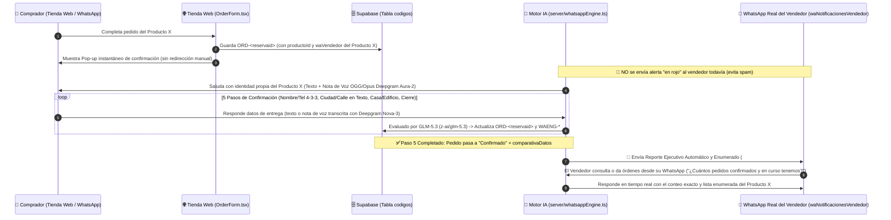

# 📲 Arquitectura de Reportes Directos al Vendedor por WhatsApp, Panel de Confirmados y Sincronización Universal en Base de Datos

> **Documento Técnico de Arquitectura — NOELUX E-Commerce & Agente IA de Ventas y Logística**
> Este documento detalla la tecnología de **Comunicación y Reportes Ejecutivos Directos del Agente IA al WhatsApp del Dueño del Producto (Vendedor)**, el **Panel Exclusivo de Pedidos Confirmados y Logística Universal**, la **Eliminación Total de Números por Defecto por Producto**, y la **Sincronización Multi-Dispositivo en Supabase mediante Tombstones (`DEL-ORD-*`)**.

---

## 1. Visión General de la Nueva Tecnología: Agente IA ↔ Dueño del Producto (Vendedor)

En la operación diaria de e-commerce, el dueño o vendedor de un producto no siempre tiene tiempo de abrir el panel administrativo web (`/admin`) para revisar cuántos pedidos entraron, cuáles están en proceso de confirmación con el cliente y cuáles ya están listos para despachar.

Para resolver esto, se creó una **Tecnología de Reportes Ejecutivos Directos por WhatsApp por Producto**:

1. **Interfaz Limpia de Configuración (`🔔 Avisos al Vendedor`):**
   - Ubicada en la barra superior de herramientas de cada producto en `/admin` (`src/components/ProductSellerAgentPanel.tsx`).
   - Su **única función** en la interfaz web es permitir que el administrador registre y guarde el **número de WhatsApp del vendedor/dueño de ese producto específico** (`waNotificacionesVendedor`), sincronizado directamente en Supabase (`CFG-<id>`).
   - **Sin botones manuales ni chats simulados en la web:** El vendedor no entra a esta pantalla a chatear con el agente ni a oprimir botones de aviso manual. Toda la interacción ocurre **directamente en el WhatsApp real del vendedor**.

2. **Cómo opera el Agente IA con el Vendedor en WhatsApp (`server/whatsappEngine.ts`):**
   - **Cero Spam de Pedidos Incompletos ("En Rojo"):** Cuando un comprador llena el formulario en la tienda web, el pedido nace en estado `Pendiente` (en curso de confirmación). El Agente IA **no molesta** al vendedor con alertas prematuras de pedidos sin confirmar; primero conversa con el comprador por WhatsApp y ejecuta los **5 Pasos de Confirmación**.
   - **Reporte Ejecutivo Automático al Confirmar (Paso 5):** En el instante en que el comprador confirma todos sus datos y el Agente IA cierra el Paso 5 (`Confirmado`), el Agente IA se comunica automáticamente con el WhatsApp del vendedor (`waNotificacionesVendedor`) y le entrega un **Reporte Ejecutivo Humano, Espaciado y Enumerado (`#1`, `#2`, `#3`...)**.
   - **Conversación Bidireccional Vendedor ↔ Agente IA desde WhatsApp:** Si el vendedor le escribe al Agente desde su propio WhatsApp (por ejemplo: *"¿Cuántos pedidos tenemos confirmados hoy?"*, *"¿Cuántos están en curso de confirmación?"*, *"Pasame el reporte actualizado"* o *"Marcá como enviado el pedido de Richard"*), el motor detecta que el remitente es el dueño del producto (`handleIncomingSellerWhatsAppInstruction`), consulta en tiempo real los pedidos de ese producto y le responde como un asistente ejecutivo humano con el estado exacto de la operación.

---

## 2. Diagrama de Flujo: Agente IA, Comprador y Dueño del Producto

---

## 3. Estructura del Reporte Ejecutivo en el WhatsApp del Vendedor

El generador de reportes (`buildSellerExecutiveWhatsAppReport` en `src/utils/orderConfirmation.ts` y `buildServerExecutiveWhatsAppReport` en `server/whatsappEngine.ts`) construye un informe claro, profesional y fácil de leer desde el celular:

- **Encabezado del Producto y Motivo del Reporte:** Indica el nombre del producto y el pedido que acaba de confirmarse o actualizarse.
- **Resumen Ejecutivo de Conteos:**
  - `✅ Confirmados por el Agente IA: X`
  - `⏳ En curso de confirmación (hablando con el cliente): Y`
  - `🚚 Enviados en camino: Z`
  - `💰 Concretados (entregados y cobrados): W`
- **Lista Enumerada de Pedidos Confirmados (`#1`, `#2`, `#3`...):**
  - Número de orden en la lista (`#1`), nombre del cliente, código de reserva (`NX-XXXXXX`), teléfono, unidades y total en Guaraníes (`Gs.`).
  - Ciudad/Barrio, Dirección/Referencia y Día/Hora acordados en el chat.
  - Estado logístico actual (`ENVIADO`, `CONCRETADO` o `PENDIENTE DE DESPACHO`).
- **Detalle de Pedidos en Curso de Confirmación:**
  - Enumera de forma compacta qué clientes están conversando actualmente con el Agente IA y aún no completaron el Paso 5.

---

## 4. Panel Exclusivo de Pedidos Confirmados y Logística Universal (`ProductConfirmedOrdersPanel.tsx`)

En el panel administrativo (`/admin`), cada producto cuenta con dos niveles complementarios para gestionar sus pedidos:

### 4.1 Tabla Inferior ("Clientes de este Producto" — Pie de Página del Producto)
- Muestra **todos los pedidos que van llegando** de ese producto (tanto pendientes como confirmados).
- Permite **marcar o desmarcar un pedido en verde (`Confirmado`)** manualmente desde el botón de estado si el administrador desea hacerlo directamente en la lista general.
- Cuando un pedido está confirmado (por el Agente IA en el Paso 5 o manualmente), despliega una **franja verde de ancho completo (`✅ CONFIRMADO`)** con un botón desplegable (`Ver resumen y comparativa IA`) que muestra lado a lado:
  1. **Datos del Formulario Web (Antes):** Nombre, Ciudad, Dirección/Referencia, Cantidad y Total originales.
  2. **Datos Confirmados en Chat por el Agente IA (Después):** Ciudad/Barrio validado, Dirección exacta/Referencia, Fecha/Hora de entrega acordada, Ubicación GPS y Nota del Agente.

### 4.2 Botón `[✅ Confirmados (N)]` en la Barra del Producto (`src/components/ProductConfirmedOrdersPanel.tsx`)
- Ubicado en la barra de herramientas del producto junto al botón `🎙️ Voz`.
- **Filtra y muestra ÚNICAMENTE los pedidos confirmados** de ese producto.
- Cada pedido confirmado se presenta como una **tarjeta horizontal numerada (`#1`, `#2`, `#3`...)** limpia y espaciada.
- Al hacer clic en una tarjeta numerada (`<button aria-expanded>`), se despliega:
  - Los datos exclusivos del comprador (Teléfono, Código de Reserva, Unidades, Total en Gs., Ciudad, Dirección y Hora acordada).
  - La **Comparativa IA (Formulario Web vs. Confirmado por WhatsApp)**.
  - La **Barra de Función Logística Universal del Producto** en una sola fila horizontal:
    - `[ 📦 Marcar No Enviado ]` (`estadoEnvioProducto: 'no_enviado'`)
    - `[ 🚚 Marcar Enviado ]` (`estadoEnvioProducto: 'enviado'`)
    - `[ 💰 Marcar Concretado (Entregado y Cobrado) ]` (`estadoEnvioProducto: 'concretado'`, `concretadoCobrado: true`)

---

## 5. Eliminación Total de Números por Defecto y Enrutamiento por Producto (`waVendedor` + `productoId`)

- **Cero números hardcodeados de respaldo:** Se eliminó por completo cualquier número por defecto en `src/config.ts` (`DEFAULT_WHATSAPP = ''`, `FALLBACK_WHATSAPP = ''`).
- **Resolución estricta desde Base de Datos (`resolveProductSellerWa`):** Cada producto almacena su propio número de WhatsApp de atención en Supabase (`waVendedor`, por ejemplo `595973532550` para `prod-noelux-01`) y su número de reportes al vendedor (`waNotificacionesVendedor`).
- **Trazabilidad en cada Pedido (`Order`):**
  - Al crearse un pedido en `OrderForm.tsx`, el objeto `Order` guarda explícitamente `productoId` y `waVendedor` del producto comprado y el cliente es redirigido mediante `buildOrderWhatsAppUrl(productWa, mensaje)` exclusivamente al WhatsApp configurado para ese producto.

---

## 6. Sincronización Universal Multi-Dispositivo en Supabase (`DEL-ORD-*`, `ORD-*`, `CFG-*`)

### 6.1 Causa Raíz de la Inconsistencia Anterior entre Web, Móvil y Entorno Local
La tabla `codigos` de Supabase tiene políticas RLS (Row-Level Security) para la clave pública (`anonKey`) que permiten:
- `SELECT` (leer filas) ✅
- `INSERT` (`POST` para crear filas) ✅
- **Pero bloquean `DELETE`** (devolviendo `HTTP 200 OK` con `0` filas eliminadas en la base de datos) ❌.

Como consecuencia:
1. Cuando el administrador eliminaba pedidos en la Web en Producción, se guardaba una lista local en `localStorage` (`mis_pedidos_eliminados_v1`) que los ocultaba **solo en ese navegador web**.
2. Al abrir `/admin` desde el **Móvil**, al **borrar la caché/historial del navegador** o al abrir el **Entorno de Desarrollo Local**, `localStorage` estaba vacío y Supabase volvía a entregar todos los registros `ORD-*` antiguos porque el `DELETE` había sido ignorado por RLS.
3. De igual manera, la voz del agente (`selectedVoiceId`) y los avisos del vendedor tenían bloqueos o almacenamiento en `localStorage`, impidiendo que los cambios hechos en un dispositivo se reflejaran en todos los demás.

### 6.2 Solución Implementada: Tombstones Permanentes (`DEL-ORD-*`), Limpieza de Residuos y Sincronización Total en `codigos`
Para garantizar consistencia 100% real en la base de datos sin depender de `localStorage` ni acumular residuos:

1. **Eliminación Permanente en Base de Datos vía `POST /rest/v1/codigos` (`DEL-ORD-<reservaid>`):**
   - Cuando se elimina un pedido desde cualquier dispositivo (Web Producción, Móvil o Desarrollo Local), `deleteOrder()` en `src/context/StoreContext.tsx` y `/api/orders/delete` en `server/whatsappEngine.ts` insertan un registro permanente en la tabla `codigos`:
     - `codigo`: `"DEL-ORD-<reservaid>-<timestamp>"` (ej. `"DEL-ORD-NX-159516-1793891500"`)
     - `dispositivo`: JSON con `{ deletedOrderId: reservaid, customerPhone, deletedAt: new Date().toISOString() }`
   - Dado que `INSERT` (`POST`) está permitido por RLS en `codigos`, el registro de eliminación queda grabado de forma inmediata y permanente en Supabase.
   - Inmediatamente, el backend ejecuta `purgeOrphanedChatsAndResidues()`, borrando chats, pasos y estados en memoria correspondientes a ese pedido.

2. **Eliminación Total del Bucle de Sobrescritura `WACHAT-*`:**
   - La tabla `codigos` de Supabase bloquea `DELETE` y `PATCH` para el `anonKey`, lo que dejaba registros viejos de 50 mensajes huérfanos en la nube.
   - Se removió definitivamente de `pollCloudCommandsAndOrders()` el ciclo que leía `WACHAT-*` de Supabase y sobreescribía la memoria de Railway.
   - Railway es ahora el único maestro que emite el estado limpio y completo a través de `WAENG-*`.

3. **Reinicio Limpio para Nuevos Pedidos:**
   - Cuando entra una orden nueva para cualquier número telefónico (`existingIdx === -1`), `storage.chats[cleanPhone]` se inicializa en `[]` y `storage.convSteps[cleanPhone] = 1`, garantizando que ninguna orden nueva herede residuos de pedidos anteriores.

4. **Filtrado Universal en Todos los Dispositivos y en el Servidor IA:**
   - Tanto `refreshOrders()` en el frontend (`StoreContext.tsx`) como `pollCloudCommandsAndOrders()` en el backend (`server/whatsappEngine.ts`) consultan en paralelo `ORD-*` y `DEL-ORD-*` desde Supabase.
   - Cualquier pedido cuyo `reservaid` tenga un `DEL-ORD-<reservaid>` en Supabase es descartado automáticamente en **Web Producción, Móvil (incluso borrando caché/historial), Entorno de Desarrollo Local y el Motor de WhatsApp**.

5. **Sincronización de Configuraciones de Producto (`CFG-<id>`):**
   - `vozAgente` (ID de voz de Deepgram Aura-2 por producto), `waVendedor` (WhatsApp donde escriben los clientes) y `waNotificacionesVendedor` (WhatsApp donde el vendedor recibe reportes) se guardan en el registro `CFG-<id>` del producto en Supabase.
   - Se eliminó el bloqueo de `localStorage` sobre `selectedVoiceId` en `AdminView.tsx`, de modo que al seleccionar un producto en cualquier dispositivo se carga siempre la configuración real almacenada en la base de datos.

---

## 7. Lógica Post-Confirmación (Bloqueo por Chat + Derivación a Llamada) y Edición Manual Post-Llamada

1. **Pedido Confirmado Inmutable por Chat (`buildPostConfirmationLLMSystemPrompt`):**
   - Una vez que el pedido alcanza el **Paso 5 (`datosConfirmados = true`)**, el pedido queda **cerrado e inmutable para cambios por mensajería**.
   - Si el cliente vuelve a escribir al número después de confirmar:
     - **Jamás dice que es una IA:** habla siempre como un operador humano del área de envíos/despacho.
     - **Si pide cualquier cambio, agregar o quitar unidades, o cancelar:** le explica profesionalmente que su orden ya fue confirmada en despacho y **lo obliga amablemente a llamar por teléfono a ese mismo número** para que un **especialista del área de ventas** gestione el cambio o la cancelación en vivo.
     - **Si hace una consulta congruente sobre el producto o el envío:** responde su duda con naturalidad y le recuerda el número por si desea llamar a un especialista de ventas.
     - **Si escribe algo no congruente con el producto:** le responde con educación aclarando que esa línea es exclusiva del área de despacho del producto.
2. **Edición Manual del Vendedor Post-Llamada (`ProductConfirmedOrdersPanel.tsx` y `AdminView.tsx`):**
   - Tras recibir la llamada telefónica del cliente y acordar el cambio o cancelación, el dueño entra al Panel de Administración y edita manualmente el pedido (aumentando o disminuyendo unidades con recálculo automático del precio, modificando dirección/referencia o cancelando el pedido), sincronizándose al instante en `pedidos.json` y Supabase (`syncOrderUpdateToCloud`).

---

## 8. Integración de Identificadores WhatsApp LID y Reportes Ejecutivos Ininterrumpidos

Para que el Agente IA pueda generar el **Reporte Ejecutivo Verde al Vendedor** al completar el Paso 5, es estrictamente necesario que la conversación previa (Pasos 1 al 4) nunca se congele:

1. **Garantía Anti-Congelamiento de Turnos:**
   - En WhatsApp Multi-Device (2025/2026), los mensajes entrantes de clientes llegan frecuentemente como `@lid`. Si el LID no estaba indexado, las versiones anteriores descartaban la respuesta del cliente, impidiendo que el pedido avanzara al Paso 5 y dejando al vendedor sin su reporte.
   - Con la **Heurística de Contacto Reciente** y el **Pre-Caché Proactivo (`getLIDForPN`)**, todo mensaje entrante se asocia deterministamente al pedido activo correspondiente.
2. **Disparo Inmediato del Reporte Verde:**
   - Al llegar al Paso 5, `matchedOrder.datosConfirmados` pasa a `true` y se dispara `notifySellerOfOrderEvent(matchedOrder, 'green')`.
   - El vendedor recibe el informe enumerado (`#1`, `#2`...) directamente en su WhatsApp registrado (`waNotificacionesVendedor`), con la comparativa web vs. chat completa.
3. **Respaldo Ininterrumpido de Credenciales en Supabase:**
   - La inclusión de la clave pública `anonKey` por defecto en el código del servidor garantiza que las lecturas y escrituras hacia `codigos` (`ORD-*`, `DEL-ORD-*`, `WAENG-*`, `CFG-*`) jamás se interrumpan en Railway, aun ante reinicios o despliegues continuos.

---

## 9. Arquitectura de Comprobantes Bancarios, Interruptor de Verificación y Pestaña Exclusiva `💎 Pago Adelantado`

Cuando un comprador participa de la promoción de **Pago Adelantado (-Gs. 50.000)** y envía su comprobante de transferencia por WhatsApp:

### 9.1. Dos Estados Diferenciados con Brillo Característico (No Verde)
1. **Estado 1 — `⚡ PAGO ENVIADO (VERIFICAR)` (`isOrderPrepaymentSentPendingVerification`):**
   - Se activa automáticamente apenas el comprador envía la imagen o PDF del comprobante por WhatsApp (`pagoAdelantadoComprobanteRecibido = true`, `pagoAdelantadoVerificadoAdmin = false`, `pagoAdelantadoEstado = 'pago_enviado_por_verificar'`).
   - **Jamás dice "Pagado" todavía:** muestra la insignia **`⚡ PAGO ENVIADO (VERIFICAR)`** y resalta toda la tarjeta del pedido con un **brillo Ámbar/Dorado-Fucsia pulsante** (claramente distinto al verde de los confirmados normales) para que el vendedor lo identifique al instante.
2. **Estado 2 — `💎 PAGO ADELANTADO` (`isOrderPrepaymentVerifiedAndPaid`):**
   - Se activa únicamente cuando el vendedor verifica en su app bancaria que el dinero ingresó y enciende el **Interruptor (`Confirmar Pago Adelantado`)** dentro del pedido (`pagoAdelantadoVerificadoAdmin = true`, `pagoAdelantadoEstado = 'pagado_adelantado_confirmado'`).
   - Resalta con un **brillo Cian/Oro VIP** y mueve el pedido automáticamente a la nueva pestaña exclusiva **`💎 Pago Adelantado`**.

### 9.2. Bloque Desplegable de Verificación Bancaria (`PrepaymentVerificationSection` en `src/components/ProductConfirmedOrdersPanel.tsx`)
Al desplegar un pedido, el vendedor visualiza en un solo panel:
- **Titular / Cliente que Transfiere:** Nombre completo (`ord.nombre`) y WhatsApp (`ord.celular`) para cotejar el remitente en la app del banco.
- **Cuenta y Banco Destino:** `Banco Familiar` · Alias `3856033 (3.856.033)` · Titular `Richard Almirón` y el monto exacto con descuento (`Gs. 139.000` / `monto - 50.000`).
- **Comprobante del Pago (`comprobantePagoDataUrl`):** Miniatura interactiva con visor modal en pantalla completa y botón para subir/reemplazar captura manualmente.
- **Interruptor (`switch-verify-prepayment-<reservaid>`):** Al activarlo, marca el pedido como `pagado_adelantado_confirmado` y lo traslada de pestaña.

### 9.3. Nueva Pestaña Exclusiva `💎 Pago Adelantado (N)` y Exclusión de `✅ Confirmados`
- Dentro de cada producto en `/admin` (`AdminView.tsx` y `ProductConfirmedOrdersPanel.tsx`), junto a `✅ Confirmados (N)` existe la pestaña **`💎 Pago Adelantado (N)`** (`panelMode = 'pagos_adelantados'`).
- **Regla de Exclusividad Estricta:**
  - La pestaña `✅ Confirmados` filtra `orders.filter(o => isOrderConfirmedByAgent(o) && !isOrderPrepaymentVerifiedAndPaid(o))`.
  - La pestaña `💎 Pago Adelantado` filtra `orders.filter(o => isOrderPrepaymentVerifiedAndPaid(o))`.
  - De este modo, **una vez que un pedido confirmado pasa a `💎 Pago Adelantado`, deja de figurar en `✅ Confirmados`** y vive exclusivamente en su pestaña de pagos adelantados verificados.
