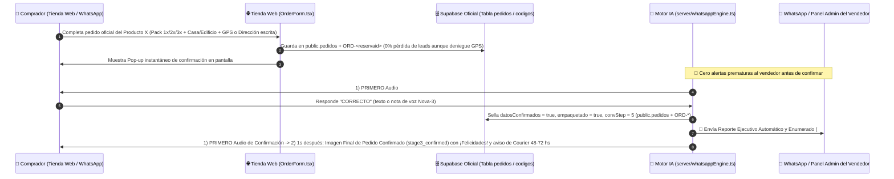

# 📲 Arquitectura de Reportes Directos al Vendedor por WhatsApp, Panel de Confirmados y Sincronización Universal en Paralelo sobre Base de Datos

> **Documento Técnico de Arquitectura — NOELUX E-Commerce & Agente IA de Ventas y Logística**
> Este documento detalla la tecnología de **Comunicación y Reportes Ejecutivos Directos del Agente IA al WhatsApp del Dueño del Producto (Vendedor)** tras la **Confirmación Express en 1 Paso (`"CORRECTO"`)**, el **Panel Exclusivo de Pedidos Confirmados**, el **Muro de Hierro de Pedidos Oficiales**, y la **Sincronización Multi-Dispositivo en Paralelo sobre Supabase Oficial (`https://pgpmopannzzubunuhlmb.supabase.co`)**.

---

## 1. Visión General: Agente IA ↔ Comprador ↔ Dueño del Producto (Vendedor)

En la operación diaria de e-commerce Contra Entrega (COD), el dueño o vendedor de un producto necesita que los pedidos se confirmen rápido sin perder clientes por exceso de preguntas y recibir únicamente reportes limpios de pedidos listos para despachar:

1. **Interfaz Limpia de Configuración (`🔔 Avisos al Vendedor`):**
   - Ubicada en la barra de herramientas de cada producto en `#admin` (`src/components/ProductSellerAgentPanel.tsx`).
   - Permite registrar y guardar el **número de WhatsApp del vendedor/dueño de ese producto específico** (`waNotificacionesVendedor`), sincronizado directamente en Supabase (`CFG-<id>`).
   - Toda la entrega de reportes ocurre **directamente en el WhatsApp real del vendedor**.

2. **Cómo opera el Agente IA con el Comprador y con el Vendedor (`server/whatsappEngine.ts`):**
   - **Cero Spam de Pedidos Incompletos ("En Rojo") y Compuerta Audio-Primero (`1s`):** Cuando un comprador llena el formulario oficial en la tienda web, el pedido nace en estado `Pendiente` (esperando validación Express). El Agente IA **no molesta** al vendedor con alertas prematuras: primero envía al comprador el **Audio #1 (`Deepgram Aura-2`)** pidiendo confirmar únicamente con la palabra **`"CORRECTO"`**, y **1 segundo (`1000ms`) después del audio** envía automáticamente la **Imagen #1 Personalizada `1080×1080` (`stage1_welcome`)** con todos sus datos.
   - **Reporte Ejecutivo Automático y Cierre al Confirmar (`"CORRECTO"`):** En el instante en que el comprador responde **`"CORRECTO"`**, el Agente IA sella el pedido como `Confirmado` (`datosConfirmados = true`, `empaquetado = true`, `agenteCompletado = true`, `convStep = 5`), se comunica automáticamente con el WhatsApp del vendedor (`waNotificacionesVendedor`) entregándole el **Reporte Ejecutivo Humano, Espaciado y Enumerado (`#1`, `#2`, `#3`...)**, envía al comprador **primero el Audio de Confirmación** informándole que su pedido ya pasa directo a empaquetado, y **1 segundo (`1000ms`) después del audio** envía por última etapa la **Imagen Impactante de Pedido Confirmado (`stage3_confirmed`)** a nombre del cliente con felicitaciones (**`¡FELICIDADES!`**) y el aviso de que en **48 a 72 horas** la transportadora / los agentes del courier entrarán en contacto y le estarán llamando para entregarle el producto.
   - **Conversación Bidireccional Vendedor ↔ Agente IA desde WhatsApp:** Si el vendedor le escribe al Agente desde su propio WhatsApp (*"reporte"*, *"estado de pedidos"*, *"¿cuántos pedidos confirmados tenemos?"* o *"marcá como enviado el pedido de..."*), `handleIncomingSellerWhatsAppInstruction` consulta en tiempo real los pedidos oficiales del producto y le responde con el conteo exacto y la lista enumerada actualizada.

---

## 2. Diagrama de Flujo: Confirmación Express, Compuerta Audio-Primero (`1s`), Reporte al Vendedor y Sincronización Continua

---

## 3. Estructura del Reporte Ejecutivo en el WhatsApp del Vendedor

El generador de reportes (`buildSellerExecutiveWhatsAppReport` en `src/utils/orderConfirmation.ts` y `buildServerExecutiveWhatsAppReport` en `server/whatsappEngine.ts`) construye un informe ejecutivo claro y legible desde el celular:

- **Encabezado del Producto y Motivo del Reporte:** Nombre del producto y pedido recién confirmado o actualizado.
- **Resumen Ejecutivo de Conteos:**
  - `✅ Confirmados por el Agente IA: X`
  - `⏳ En curso de confirmación (esperando respuesta del cliente): Y`
  - `🚚 Enviados en camino: Z`
  - `💰 Concretados (entregados y cobrados): W`
- **Lista Enumerada de Pedidos Confirmados (`#1`, `#2`, `#3`...):**
  - Número de orden (`#1`), nombre del cliente, código de reserva (`NX-XXXXXX`), teléfono, unidades y total en Guaraníes (`Gs.`).
  - Ciudad/Barrio, Dirección/Referencia, Tipo de Vivienda (`Casa` / `Edificio`) y enlace GPS validado.
  - Estado logístico actual (`ENVIADO`, `CONCRETADO` o `LISTO PARA ENVIAR`).
- **Detalle de Pedidos en Espera de Confirmación:**
  - Enumera de forma compacta qué clientes recibieron ya la bienvenida Express y aún no enviaron su confirmación.

---

## 4. Panel Exclusivo de Pedidos Confirmados y Logística Universal (`ProductConfirmedOrdersPanel.tsx` y `AdminView.tsx`)

En el panel administrativo (`#admin`), la primera tarjeta de producto se despliega automáticamente al entrar para mostrar todos los pedidos al instante:

### 4.1. Tarjetas Horizontales con Acción Directa y Comparativa IA
- Muestra los pedidos oficiales del producto con numeración clara, estado del Agente IA y botón de **Chat de WhatsApp en Vivo**.
- Al desplegar un pedido confirmado se visualiza lado a lado:
  1. **Datos del Formulario Web (Antes):** Nombre, Teléfono, Ciudad, Dirección, Vivienda, Pack y Total originales.
  2. **Datos Confirmados en Chat por el Agente IA (Después):** Ciudad/Barrio validado, Dirección/Edificio y Ubicación GPS confirmada.

### 4.2. Sub-Pestaña `[✅ Confirmados (N)]` y Barra Logística Universal
- **`✅ Confirmados (N)`:** Muestra todos los pedidos confirmados por el Agente IA listos para empaquetar y despachar.
- **Barra de Función Logística Universal** en una sola fila táctil:
  - `[ 📦 Marcar No Enviado ]` (`estadoEnvioProducto: 'no_enviado'`)
  - `[ 🚚 Marcar Enviado ]` (`estadoEnvioProducto: 'enviado'`)
  - `[ 💰 Marcar Concretado (Entregado y Cobrado) ]` (`estadoEnvioProducto: 'concretado'`, `concretadoCobrado: true`)

---

## 5. Eliminación Total de Números por Defecto y Enrutamiento Estricto por Producto (`waVendedor` + `productoId`)

- **Cero números hardcodeados de respaldo:** `DEFAULT_WHATSAPP = ''` y `FALLBACK_WHATSAPP = ''` en `src/config.ts`.
- **Resolución estricta desde Base de Datos (`resolveProductSellerWa`):** Cada producto almacena en Supabase su propio número de atención al cliente (`waVendedor`) y su número de reportes ejecutivos (`waNotificacionesVendedor`).
- **Trazabilidad completa:** Todo pedido creado en `OrderForm.tsx` guarda `productoId` y `waVendedor` del producto adquirido.

---

## 6. Sincronización Universal Multi-Dispositivo en Paralelo sobre Supabase Oficial (`pedidos`, `ORD-*`, `DEL-ORD-*`, `CFG-*`)

Toda la persistencia multi-dispositivo opera al 100% sobre **Supabase Oficial (`https://pgpmopannzzubunuhlmb.supabase.co`)** con autocuración en tiempo real:

1. **Sincronización Continua en `GET /api/pedidos` (`vite.config.ts`):**
   - `GET /api/pedidos` sincroniza periódicamente con Supabase (`pollCloudCommandsAndOrders(true)`) incluso cuando ya existen pedidos en el caché local, garantizando que cualquier pedido creado o confirmado llegue de inmediato al panel administrativo.
2. **Autocuración en `pollCloudCommandsAndOrders` (`server/whatsappEngine.ts`):**
   - Verifica que el `reservaid` exista realmente en `pedidos.json` local antes de omitir un registro por `processedCloudOrders`. Si un pedido activo en `public.pedidos` de Supabase falta localmente, se restaura y fusiona automáticamente sin perder el avance (`convStep`, `datosConfirmados`, `agenteCompletado`, `empaquetado`).
3. **Consultas en Paralelo en el Frontend (`refreshOrders` en `src/context/StoreContext.tsx`):**
   - Ejecuta simultáneamente (`Promise.allSettled`) las lecturas de `DEL-ORD-*`, `ORD-*`, `public.pedidos` y `/api/pedidos` cada 4 segundos, actualizando la vista de Administración sin bloqueos secuenciales.
4. **Eliminación Permanente vía Tombstones (`DEL-ORD-<reservaid>`):**
   - Al eliminar un pedido desde cualquier dispositivo, se inserta `DEL-ORD-<reservaid>-<timestamp>`, se borra de `public.pedidos` y se ejecuta `purgeOrphanedChatsAndResidues()`.
5. **Higiene de Despliegue (`.gitignore`):**
   - `pedidos.json`, `deleted_orders.json`, `wa_chats.json`, `seller_agent_chats.json`, `store_config.json` y `**/promo_prepayment.jpg` están excluidos en `.gitignore` para que ningún despliegue arrastre cachés locales viejos ni activos eliminados.

---

## 7. Lógica Post-Confirmación (Bloqueo por Chat + Derivación a Llamada) y Edición Manual Post-Llamada

1. **Pedido Confirmado Inmutable por Chat (`buildPostConfirmationLLMSystemPrompt`):**
   - Una vez confirmado el pedido, el Agente IA **jamás modifica cantidades, precios ni cancela el pedido por chat**.
   - Responde **100% en Nota de Voz (`Deepgram Aura-2`)** como operador humano de despacho: si el cliente solicita agregar/quitar unidades o cancelar, lo invita amablemente a **llamar por teléfono a ese mismo número** para ser atendido en vivo por un **Especialista del Área de Ventas**.
2. **Edición Manual Post-Llamada (`ProductConfirmedOrdersPanel.tsx` y `AdminView.tsx`):**
   - Tras hablar por teléfono con el cliente, el vendedor ajusta unidades (`-` / `+`), monto, dirección o estado en el panel admin y sincroniza al instante en Supabase (`syncOrderUpdateToCloud`).

---

## 8. Diseño Compacto para Pantallas de 11", Botones de Copiado Individual y Resumen 1-Clic para Courier (`formatFullOrderTextForCourier`)

1. **Distribución Compacta en Dos Columnas (`ProductConfirmedOrdersPanel.tsx`):**
   - Adaptada a notebooks de 11" y móviles en modo oscuro puro sin scroll innecesario.
2. **Botones de Copiado Individual 1-Clic:**
   - Copiado instantáneo con confirmación visual (`Copiado!`) para **Nombre**, **Teléfono (`09XXXXXXXX`)**, **Ciudad**, **Dirección** y **Mapa GPS**.
3. **Resumen Completo para Delivery (`📋 Copiar Todo el Resumen para Delivery`):**
   - Genera el bloque completo listo para enviar al courier/motomensajería con todos los datos verificados y enlace de Google Maps.
