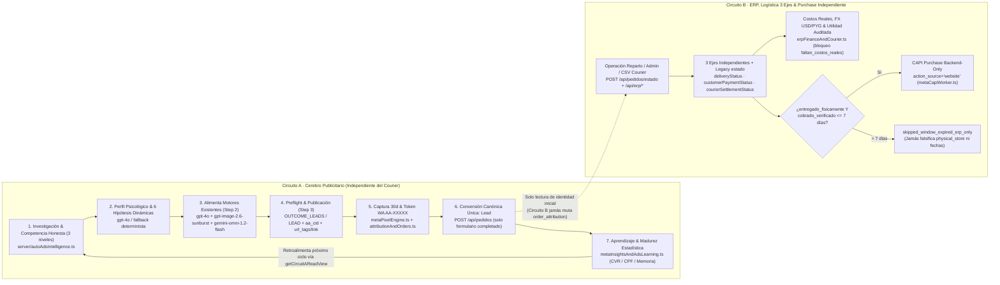

# 🧠 CEREBRO AUTOADS v2 — Arquitectura Central de Inteligencia Publicitaria, Psicológica y Aprendizaje COD

Este documento describe exclusivamente la arquitectura y el código **realmente implementados** en el repositorio para el **Cerebro de Inteligencia Publicitaria de AutoAds (`AutoAds v2`)**.

> **Regla fundamental de diseño:** Se conservaron al 100% los motores operativos existentes (imágenes, vídeos, textos base, publicación Directa en Meta y publicación mediante Pipeboard MCP) y el flujo de 3 pasos en [`src/components/AutoAdsView.tsx`](./src/components/AutoAdsView.tsx):
> **`1. INVESTIGAR` → `2. CREAR ANUNCIOS IA` → `3. PUBLICAR EN META ADS`**, ahora organizado mediante pestañas horizontales (`Crear Campaña`, `Campañas`, `Cuenta Meta & CAPI`) y tarjetas de campaña en cabecera sin alterar ninguna lógica.
> Toda la nueva inteligencia opera internamente desde el backend.

---

## 1. Arquitectura General y Principio de Dos Circuitos Aislados

El sistema separa estrictamente la **optimización publicitaria** (Circuito A) de la **operación logística, financiera y fiscal** (Circuito B) para evitar que los tiempos o devoluciones del courier contaminen las señales de aprendizaje de Meta Ads y de AutoAds:

### Regla de Aislamiento Absoluto (`Circuito A ⊥ Circuito B`)
- **Módulo de puente sanitario (`server/autoadsStore.ts`):** `getCircuitAReadView(productSlug)` es la única puerta de lectura permitida para `autoAdsIntelligence.ts` y `metaInsightsAndAdsLearning.ts`.
- Proyecta **únicamente** pedidos confirmados sanitizados (`reservaId`, `producto`, `confirmedFormAt`, `canonicalConversionEvent: 'Lead'` e IDs de atribución), `attributions`, `adEntities`, `metaDailyInsights`, `learningMemory`, `hypotheses` y `dossiers`.
- **Nunca** lee ni expone `estado`, `deliveryStatus`, `customerPaymentStatus`, `courierSettlementStatus`, `netCashCollectedPyg`, `courierFeePyg`, `productUnitCostPyg`, `returnCostPyg`, liquidaciones bancarias ni `Purchase`.
- La función `POST /api/pedidos/estado` en `vite.config.ts` además elimina explícitamente cualquier propiedad de atribución (`attributionSnapshot`, `attributedAdId`, `canonicalLeadEventId`, etc.) si llegara dentro de `updates`, asegurando que el circuito logístico **jamás altere la atribución original**.

---

## 2. Integración en los 3 Pasos Existentes (Zero Cambios de UI)

El operador continúa utilizando exactamente los mismos tres botones en `AutoAdsView.tsx`:

| Paso UI Existente | Botón / Acción del Usuario | Qué Ejecuta Internamente el Cerebro v2 |
|---|---|---|
| **1. INVESTIGAR** | Clic único de investigación / entrenamiento (`POST /api/autoads/brain-train`) | Si `AUTOADS_STRATEGY_V2_ENABLED` está activo, ejecuta `runPsychologicalAndHypothesisIntelligence()`: minera competencia en 3 niveles, lee memoria histórica del Circuito A (`getCircuitAReadView`), sintetiza perfil psicológico Schwartz + **6 hipótesis dinámicas** en JSON estricto, persiste dossier e hipótesis en `autoads_research_dossiers` y `autoads_hypotheses`, y devuelve un `AutoAdsBrainProfile` 100% compatible con los briefs y tarjetas existentes (`strategyMode: 'hypothesis_v2'`). |
| **2. GENERAR TODOS LOS CREATIVOS** | Clic de generación masiva o individual (`buildCreativeAssetsFromBrain`, `POST /api/autoads/generate-ad-images`, `POST /api/autoads/regenerate-ad`) | Preserva el copy psicológico y los hooks de pregunta usando `sanitizeAdCopyForParaguayCod(..., { policyGuardOnly: true })` (elimina promesas irreales de entrega hoy mismo, jerga `"contra entrega"` y restos de marca sin truncar ni sobreescribir el hook de las hipótesis). Respeta el `aiImagePrompt` específico de cada hipótesis al invocar a **`openai/gpt-image-2.6-sunburst`** (soportando `1:1` y `9:16`) y el `videoScriptPrompt` al invocar a **`google/gemini-omni-1.2-flash`**, conservando la trazabilidad `hypothesisId`, `angleId`, `hypothesisCode` y `testVariable`. |
| **3. PUBLICAR EN META ADS** | Clic de publicación Directa (`POST /api/meta/publish-direct`) o Pipeboard MCP (`POST /api/pipeboard/publish-campaign`) | Ejecuta `runMetaPublishPreflight()`: verifica moneda real de la cuenta (`PYG` sin centavos vs `USD` en centavos), valida objetivo **`OUTCOME_LEADS`** + evento **`LEAD`**, emite advertencia **no bloqueante** si el píxel tiene pocos eventos `Lead` en los últimos 7 días, genera identificadores `aa_cid`, adjunta `url_tags` dinámicos en Meta Direct o query params en `link` para Pipeboard, sube vídeos a `/advideos` cuando aplica en Direct (con fallback controlado a imagen si Pipeboard MCP no soporta vídeo) y registra cada anuncio publicado en `ad_entities`. |

---

## 3. Cómo Funciona Internamente el Cerebro Publicitario (`server/autoAdsIntelligence.ts`)

### 3.1. Investigación de Producto, Mercado y Competencia Honesta (3 Niveles)
La función `mineCompetitorsHonestly()` clasifica obligatoriamente el origen de cada hallazgo competitivo, **prohibiendo fabricar anuncios simulados bajo apariencia de verificación**:

1. **`manual_operator_evidence` (`sourceVerified: true`):** Anuncios, titulares, ofertas o URLs observados y cargados explícitamente por el operador.
2. **`verified_meta_ad_library` (`sourceVerified: true`):** Consulta real a Meta Graph API v21.0 (`GET https://graph.facebook.com/v21.0/ads_archive`) filtrando por país (`PY` por defecto), anuncios activos y término del producto usando `META_AD_LIBRARY_TOKEN` o `META_ACCESS_TOKEN`. Si la API falla o el token no tiene acceso, registra el error transparente en `competitorSourceSummary.adArchiveError` y continúa sin inventar anuncios verificados.
3. **`llm_strategic_inference` (`sourceVerified: false`):** Cuando no hay cobertura suficiente de anuncios verificados reales, genera inferencia estratégica de mercado explicitly marcada como **no verificada**.

### 3.2. Perfil Psicológico del Comprador (`PsychologicalProfileV2`)
El cerebro analiza `product.physicalTruth`, descripción, precios en Guaraníes y la evidencia competitiva junto con la memoria de experimentos pasados del Circuito A para construir:
- **Nivel de conciencia (`awarenessLevel`):** `unaware` · `problem_aware` · `solution_aware` · `product_aware` · `most_aware`.
- **Sofisticación de mercado (`marketSophistication`):** escala `1` a `5`.
- **Dolores viscerales (`visceralPains`):** frustraciones reales que motivan la búsqueda del producto.
- **Deseos profundos (`deepDesires`):** transformación práctica buscada en el hogar o rutina diaria.
- **Sesgos y disparadores cognitivos (`cognitiveBiasesAndTriggers`).**
- **Objeciones reales del comprador COD en Paraguay (`paraguayCodObjections`):** miedo a estafas/transferencias previas, dudas de durabilidad o funcionamiento, miedo a costos ocultos, con su respectivo *reframe*.
- **Mecanismo Único (`uniqueMechanismProblem` vs `uniqueMechanismSolution`):** explicación diferenciadora de por qué fallan las copias genéricas y por qué funciona este producto.

### 3.3. Generación de Hipótesis, Ángulos, Promesas y Conceptos Creativos (`AutoAdsHypothesisV2`)
En lugar de usar 6 plantillas fijas iguales para todo producto, el cerebro construye **6 hipótesis distintas y trazables** (con LLM **`openai/gpt-4o`** vía OpenRouter cuando hay clave disponible, o con el generador estructural `buildDiverseDynamicHypothesesFallback` en modo determinista/offline). Cada hipótesis define:
- `hypothesisCode` y `angleId` / `angleName` diferenciados (p. ej. `H1-MECANISMO`, `H2-CERO-RIESGO-COD`, contraste frente a opciones baratas, demostración práctica, economía por pack, prueba de durabilidad).
- `targetAvatar`, `corePain`, `deepDesire` y `objectionTargeted`.
- `uniqueMechanismProblem`, `uniqueMechanismSolution`, `bigIdea`, `promise` y `proofType`.
- `hookFormula` (primera frase de detención de scroll sin mutilación en modo `hypothesis_v2`), `testVariable` (qué variable se aísla en el experimento), `copyFramework` y `visualArchetype`.
- `primaryTextDraft`, `headlineDraft`, `ctaDraft`.
- `aiImagePrompt` y `videoScriptPrompt` específicos para ese ángulo psicológico.

### 3.4. Protección Copy Sin Mutilación (`policyGuardOnly`)
En `src/utils/autoAdsBrainEngine.ts`, la función `sanitizeAdCopyForParaguayCod(rawText, product, angleIdx, { policyGuardOnly })`:
- Siempre protege políticas reales de Paraguay COD: reemplaza promesas falsas de entrega en el día (*"hoy mismo en tu puerta"* → *2 a 3 días hábiles / 48 a 72 hs*), limpia restos de marcas desconocidas y traduce jerga de comerciante (*"contra entrega"* → *"pagás cuando recibís / cuando te entregamos"*).
- Cuando `strategyMode === 'hypothesis_v2'` (o existe `brief.hypothesisId`), activa **`policyGuardOnly: true`**, evitando ejecutar `enforceZeroSecondFirstWordsHook()` para conservar intactos los hooks de pregunta, mecanismos únicos y aperturas psicológicas diseñadas por las hipótesis. El modo clásico (`policyGuardOnly: false`) sigue disponible si el operador desactiva `AUTOADS_STRATEGY_V2_ENABLED`.

### 3.5. Alimentación Aditiva a los Motores Existentes (Sin Reemplazarlos)
Los motores operativos originales permanecen intactos y reciben los insumos enriquecidos:
- **Textos:** `openai/gpt-4o` (endpoint `POST /api/autoads/brain-train` y `POST /api/autoads/regenerate-ad`) alimenta `AutoAdsBrainProfile.creativeBriefs`.
- **Imágenes:** `openai/gpt-image-2.6-sunburst` (`POST /api/autoads/generate-ad-images`) recibe el `aiImagePrompt` específico del brief de cada hipótesis y respeta relación de aspecto `1:1` o `9:16`.
- **Vídeos:** `google/gemini-omni-1.2-flash` (`POST /api/autoads/generate-ad-images` / generación de Reel) recibe el `videoScriptPrompt` de la hipótesis.
- **Creatividades:** `buildCreativeAssetsFromBrain()` y `AutoAdsCreativeBrief` propagan `hypothesisId`, `angleId`, `hypothesisCode` y `testVariable` hacia `GeneratedAdCreativeAsset`.

---

## 4. Señal Canónica Única (`Lead`), Atribución Multicanal y Aprendizaje

### 4.1. Conversión Canónica Única al Completar el Formulario
- **Apertura y escritura parcial (`src/components/OrderForm.tsx`):** Al ingresar nombre y celular, el frontend únicamente dispara **`InitiateCheckout`** una vez (se eliminó el disparo prematuro de `Lead` al teclear y el disparo prematuro de `Purchase` en el checkout).
- **Confirmación de pedido en servidor (`src/context/StoreContext.tsx` → `POST /api/pedidos`):**
  1. `StoreContext` captura `visitorId` único por visitante, genera `clientRequestKey` idempotente y adjunta `attributionSnapshot`.
  2. `createOrIdempotentPedidoWithAttribution()` (`server/attributionAndOrders.ts`) persiste conjuntamente el pedido en `pedidos` y su atribución en `order_attribution` con `canonicalConversionEvent = 'Lead'` y `canonicalLeadEventId = ord_<reservaid>_Lead`.
  3. **Solo después** de recibir confirmación persistida del pedido, `OrderForm.tsx` emite **`Lead`** (navegador Pixel + First-Party CAPI gateway `/api/meta-capi/track` con el mismo `event_id` para deduplicación exacta).
- **Evento secundario opcional `OrderReservedCOD`:** Si `enabledEvents.OrderReservedCOD` y `AUTOADS_EMIT_COD_CUSTOM_EVENT` están activos, se emite como evento personalizado separado con `event_id = ord_<reservaid>_OrderReservedCOD`. Todas las campañas optimizan exclusivamente **`OUTCOME_LEADS`** (`optimization_goal = LEAD`) y `extractMetaLeadActionCount()` únicamente suma `lead` / `offsite_conversion.fb_pixel_lead` / `onsite_conversion.lead_grouped`, **nunca** `OrderReservedCOD` ni `Purchase`.
- **Idempotencia y cola de resiliencia (`cloudSyncQueue`):** Antes de insertar un pedido, `createOrIdempotentPedidoWithAttribution()` verifica duplicados por `clientRequestKey` o `reservaid` (hidratando desde Supabase si hay miss local tras un reinicio de Railway), devolviendo `idempotentReplay: true` sin duplicar pedidos ni leads. Al sincronizar en nube, `buildPedidoSupabaseRow()` mapea exactamente las columnas reales de `public.pedidos` (`cantidad`, `monto`, `producto_id`, campos legacy + las 25 columnas v2) y `order_attribution` enlaza su `pedido_id` al `id` retornado. Si Supabase falla temporalmente, el pedido y su atribución permanecen en caché local y encolados en `cloudSyncQueue` hasta recuperarse (`POST /api/sync/retry-queues`).

### 4.2. Cadena de Atribución Multicanal (Ventana 30 Días)
En navegador (`src/utils/metaPixelEngine.ts`), `captureUrlAttributionTouch()` captura UTMs, `fbclid`, `ad_id`, `adset_id`, `campaign_id`, `creative_id`, `hypothesis_id`, `angle_id` y `aa_cid`, manteniendo **`last_paid_touch` por 30 días** en `localStorage` + cookie `aa_last_paid_touch_v2` (una visita orgánica/directa posterior **nunca** borra el último toque pago vigente).

En backend, `resolveOrderAttribution()` evalúa en orden determinista:
1. **`last_paid_touch_30d`** (`paid_meta`): último toque pago dentro de 30 días.
2. **`wa_token_match`** (`paid_meta_via_wa`): código `AA-XXXXX` emitido por `POST /api/attribution/wa-token` (`wa_attribution_tokens`, vigencia 30 días) detectado en referencia/detalle o payload.
3. **`phone_stitch_30d`** (`paid_meta_phone_stitch`): coincidencia por teléfono paraguayo normalizado (`normalizeParaguayPhone()` → `5959XXXXXXXX`) en los últimos 30 días frente a tokens WhatsApp o atribuciones previas.
4. **`first_paid_touch_30d`** (`paid_meta`): respaldo al primer toque pago dentro de 30 días.
5. **Enriquecimiento determinístico `aa_cid` → `ad_entities`:** si viene `aa_cid` o `ad_id`, completa `campaign_id`, `adset_id`, `creative_id`, `hypothesis_id` y `angle_id` desde el catálogo publicado `ad_entities`.
6. **`direct`** (`method: 'none'`): si no existe señal paga vigente, clasifica honestamente como directo sin inventar atribución.

### 4.3. Métricas, Memoria Histórica y Madurez Estadística (`server/metaInsightsAndAdsLearning.ts`)
- **Sincronización Meta Insights (`POST /api/autoads/insights/sync`):** Consulta Graph v21.0 `/{act_id}/insights` a nivel `ad` (`time_increment=1`), detectando la moneda de la cuenta (`PYG` o `USD`) para normalizar gasto a `spendUsd` y `spendPyg` usando la tasa efectiva vigente, y extrae únicamente acciones `Lead` en `meta_leads_reported`.
- **Cálculo del Circuito A (`recomputeCircuitALearning` / `GET /api/autoads/learning-dashboard`):**
  - Cuenta **cada `reservaId` exactamente una vez** desde `getCircuitAReadView(productSlug)`.
  - Agrega métricas por **6 niveles**: `campaign`, `adset`, `ad`, `creative`, `hypothesis` y `angle`.
  - Calcula por cada entidad: `formsCount`, `formCvrPct = (formsCount / inlineLinkClicks) * 100`, `cpfUsd = spendUsd / formsCount` y `cpfPyg = spendPyg / formsCount`.
- **Clasificador estadístico sin espera logística (`classifyAdStatisticalVerdict`):**
  - Umbrales base (`DEFAULT_CIRCUIT_A_THRESHOLDS`): `minImpressions: 800`, `minClicks: 25`, `minSpendUsd: 5`, `targetMaxCpfUsd: 3.5`.
  - **`insufficient_data`:** aún no alcanza madurez estadística y tiene `< 3` formularios (recomienda seguir recolectando tráfico).
  - **`winner`:** `formsCount >= 2` con `cpfUsd <= targetMaxCpfUsd` o `formCvrPct >= 3.0%` (escalar presupuesto e iterar variaciones de hook).
  - **`promising`:** `formsCount >= 1` con CPF dentro de `1.45x` del objetivo.
  - **`loser`:** alcanzó madurez estadística de impresiones/clics/gasto sin producir rendimiento aceptable de formularios (pausar y rotar hacia una hipótesis alternativa).
- **Ciclo de retroalimentación:** `recomputeCircuitALearning()` guarda los resultados en `autoads_learning_memory`. En la siguiente ejecución del Paso 1 (`INVESTIGAR`), `summarizeCircuitAMemoryForPrompt()` inyecta `winningSummary` y `saturatedPatternsToAvoid` al cerebro psicológico para reforzar ángulos con bajo CPF/alto CVR y evitar repetir ángulos agotados o perdedores.

---

## 5. Validación Previa de Publicación Meta Direct y Pipeboard MCP (`server/metaPublishPreflight.ts`)

Antes de crear campañas en Meta (`POST /api/autoads/preflight`, integrado también dentro de `POST /api/meta/publish-direct` y `POST /api/pipeboard/publish-campaign`):

- **Moneda Real y Unidades Mínimas (`normalizeDailyBudgetForMetaAccount`):** Consulta la moneda real de la cuenta (`PYG`, `USD`, etc.). Para **`PYG` y otras monedas zero-decimal**, envía el entero real en Guaraníes (`minorUnits = Math.round(amount)`), **corrigiendo el bug histórico** donde Pipeboard multiplicaba por `100` montos en `PYG`. Para `USD` envía centavos (`amount * 100`).
- **Objetivo Canónico:** Usa **`OUTCOME_LEADS`** con evento de optimización **`LEAD`** sobre el píxel del producto.
- **Historial de `Lead` en Píxel (`checkPixelLeadHistoryNonBlocking`):** Si el píxel registra menos de 5 eventos `Lead` en los últimos 7 días, emite una **advertencia no bloqueante** (`PIXEL_LEAD_HISTORY_LOW`, `level: 'warning'`, `readyToPublish: true`) informando que los primeros anuncios partirán con aprendizaje nuevo, sin bloquear la publicación.
- **Trazabilidad y Medios:**
  - **Meta Direct:** Ejecuta chequeo preventivo no bloqueante (`execution_options: ['validate_only']` en Graph v21.0, clasificado siempre como `warning` informativo si arroja observación), adjunta parámetros dinámicos en `url_tags` (`utm_source`, `utm_medium`, `utm_campaign={{campaign.name}}`, `utm_content={{ad.name}}`, `campaign_id={{campaign.id}}`, `adset_id={{adset.id}}`, `ad_id={{ad.id}}`, `aa_cid`, `creative_id`, `hypothesis_id`, `angle_id`) y sube vídeos seleccionados mediante `/advideos`.
  - **Pipeboard MCP:** Inspecciona capacidades reales vía `tools/list`. Cuando `create_ad_creative` no soporta `url_tags`, inyecta `aa_cid`, `hypothesis_id`, `angle_id` y UTMs directamente en el query string del `link` (`trackingLinkMode = 'link_query_params'`). Si Pipeboard MCP no expone herramienta de vídeo, degrada con aviso a subida de imagen (`upload_ad_image`).
  - **Registro:** Cada anuncio creado se guarda en `ad_entities` (`registerAdEntitySnapshot`) para cerrar la atribución futura aunque los cookies se pierdan.

---

## 6. Circuito B Separado (ERP 3 Ejes, Costos Reales, Courier y Purchase Independiente)

Para no mezclar la contabilidad del negocio con el aprendizaje de formularios de Meta:

- **3 Ejes Logísticos Independientes (`server/attributionAndOrders.ts` → `applyOrderAxisUpdate`):**
  - `deliveryStatus`: `pendiente_envio` | `en_transito` | `entregado_fisicamente` | `devuelto` | `cancelado`.
  - `customerPaymentStatus`: `pendiente_cobro` | `cobrado_verificado` | `fallido_o_rechazado` | `reembolsado`.
  - `courierSettlementStatus`: `no_aplica` | `pendiente_liquidacion` | `liquidado_en_lote`.
  - Sincronizado bidireccionalmente con el campo legacy `estado` para compatibilidad completa con [`RepartoView.tsx`](./src/views/RepartoView.tsx) y [`AdminView.tsx`](./src/views/AdminView.tsx).
- **ERP Financiero Honesto (`server/erpFinanceAndCourier.ts`):**
  - Endpoints protegidos con `verifyAdminToken` (`/api/erp/*`): costos unitarios por producto (`/api/erp/costs`), tipos de cambio históricos USD→PYG (`/api/erp/fx-rates`), liquidaciones courier manuales (`/api/erp/settlements`) e importación CSV (`/api/erp/settlements/import-csv`), y resumen auditado (`GET /api/erp/profitability`).
  - **Regla anti-utilidades inventadas:** Si existen pedidos entregados/cobrados sin `product_cost_profiles` o costo unitario real, `computeAuditedErpProfitability()` responde `auditStatus = 'faltan_costos_reales'`, `productCogsPyg = null` y `auditedNetProfitPyg = null`. Jamás estima ni inventa márgenes.
- **Purchase CAPI Independiente (`server/metaCapiWorker.ts` → `dispatchIndependentPurchaseCapiIfEligible`):**
  - Se ejecuta únicamente desde backend al confirmarse **`deliveryStatus === 'entregado_fisicamente' && customerPaymentStatus === 'cobrado_verificado'`** (no espera liquidación bancaria del courier).
  - Usa exclusivamente **`action_source: 'website'`** y fecha real de cobro/entrega verificada.
  - Si han pasado más de **7 días** desde `confirmedFormAt`, **no envía el evento ni falsifica `physical_store` o fechas**: marca `skipped_window_expired_erp_only` y conserva el dato únicamente para el ERP.

---

## 7. Referencia Rápida de Archivos, Tablas, Endpoints y Flags

### Archivos Clave del Sistema
- **Frontend:** [`src/types.ts`](./src/types.ts), [`src/utils/autoAdsBrainEngine.ts`](./src/utils/autoAdsBrainEngine.ts), [`src/utils/pipeboardEngine.ts`](./src/utils/pipeboardEngine.ts), [`src/utils/metaPixelEngine.ts`](./src/utils/metaPixelEngine.ts), [`src/components/OrderForm.tsx`](./src/components/OrderForm.tsx), [`src/context/StoreContext.tsx`](./src/context/StoreContext.tsx), [`src/components/AutoAdsView.tsx`](./src/components/AutoAdsView.tsx) (UI 3 pasos preservada).
- **Backend (`server/` & `vite.config.ts`):**
  - [`server/autoadsStore.ts`](./server/autoadsStore.ts) (lectura y escritura autoritativa en Supabase vía `hydrateAutoadsFromSupabase`/`postgrestUpsert`, caché local no autoritativa y proyección aislada `getCircuitAReadView`)
  - [`server/autoAdsIntelligence.ts`](./server/autoAdsIntelligence.ts) (competencia 3 niveles, perfil psicológico, 6 hipótesis)
  - [`server/attributionAndOrders.ts`](./server/attributionAndOrders.ts) (atribución 30d, tokens WA, `createOrIdempotentPedidoWithAttribution`, cola de reintentos y 3 ejes)
  - [`server/metaInsightsAndAdsLearning.ts`](./server/metaInsightsAndAdsLearning.ts) (sync insights Meta, normalización USD/PYG, CVR/CPF y veredictos estadísticos)
  - [`server/metaPublishPreflight.ts`](./server/metaPublishPreflight.ts) (validación previa Meta Direct / Pipeboard MCP, `/advideos`, `ad_entities`)
  - [`server/erpFinanceAndCourier.ts`](./server/erpFinanceAndCourier.ts) (costos, FX, liquidaciones CSV y utilidad auditada Circuito B)
  - [`server/metaCapiWorker.ts`](./server/metaCapiWorker.ts) (despacho CAPI `Lead`, opcional `OrderReservedCOD`, `Purchase` independiente con ventana 7d y reintentos)
- **Base de datos, Protección de Moneda y Pruebas:**
  - [`database/autoads_v2_additive_migration.sql`](./database/autoads_v2_additive_migration.sql) (migración SQL idempotente no destructiva; **ejecutada y verificada en Supabase**)
  - [`server/autoAdsIntelligence.ts`](./server/autoAdsIntelligence.ts) + [`vite.config.ts`](./vite.config.ts): `resolveProductGuaraniPricing()`, `sanitizePromptUsdToGuaranies()` y `buildFullOpenAiAdImagePrompt()` garantizan precios 100% en **Paraguayan Guaraníes (`Gs.`)** (cero dólares / USD en copy y creatividades) más margen inferior limpio.
  - [`server/__tests__/autoadsArchitecture.test.ts`](./server/__tests__/autoadsArchitecture.test.ts) (`10/10` pruebas automatizadas: `ISO-01` a `ISO-09`, mappers Supabase/`buildPedidoSupabaseRow` y blindaje Guaraníes).

### Persistencia Autoritativa en Supabase e Hidratación Sin JSON Local (`server/autoadsStore.ts`)
- **Fuente autoritativa en producción:** Aunque el contenedor de Railway inicie con un sistema de archivos limpio (sin archivos `.json` locales en `/data/autoads_v2` ni `pedidos.json`), `hydrateAutoadsFromSupabase()` consulta en paralelo mediante `postgrestSelect()` las **11 tablas nuevas de AutoAds v2**, `public.pedidos` y la clave `AAFLAGS-v2-*` en `codigos`.
- **Sincronización sin carreras:** Toda operación mutante registra sus escrituras asíncronas (`postgrestUpsert()` / `postgrestDelete()`) y los endpoints HTTP ejecutan `await flushPendingSupabaseSyncs()` antes de responder. Los `feature_flags` persisten en `codigos` (`AAFLAGS-v2-<ts>` con limpieza automática de versiones anteriores).
- **Diagnóstico en vivo:** El endpoint `GET /health` reporta `autoadsSupabase: { configured, lastHydratedAt, lastErrors, pendingSyncCount }` para auditar conectividad e hidratación en producción.
- **Aislamiento de tests:** Cuando se define `setAutoadsDataRootForTesting()`, `getSupabaseCreds()` retorna `null` para mantener la suite unitaria 100% offline y determinista.

### Tablas Nuevas en Supabase (`autoads_v2_additive_migration.sql`)
- **Circuito A:** `order_attribution`, `wa_attribution_tokens`, `ad_entities`, `autoads_research_dossiers`, `autoads_hypotheses`, `meta_ads_daily_insights`, `autoads_learning_memory` + columnas aditivas de atribución en `pedidos`.
- **Circuito B:** `product_cost_profiles`, `fx_rate_periods`, `courier_settlements`, `meta_capi_dispatch_log` + columnas aditivas de ejes logísticos/financieros en `pedidos`.

### Feature Flags Operativas (`GET/POST /api/autoads/feature-flags`)
| Flag | Default | Efecto / Rollback Seguro |
|---|---|---|
| `AUTOADS_STRATEGY_V2_ENABLED` | `true` | Desactivarla retorna el Paso 1 al prompt clásico sin borrar datos históricos v2. |
| `AUTOADS_CANONICAL_LEAD_ONLY` | `true` | Mantiene `Lead` como única conversión canónica de formulario. |
| `AUTOADS_EMIT_COD_CUSTOM_EVENT` | `true` | Emite o suprime el evento secundario personalizado `OrderReservedCOD`. |
| `AUTOADS_PREFLIGHT_STRICT_CURRENCY` | `true` | Habilita verificación estricta de moneda real y presupuesto pre-publicación. |
| `AUTOADS_PURCHASE_CAPI_INDEPENDENT_ENABLED` | `true` | Controla el envío backend-only de `Purchase` tras entrega + cobro verificado. |

### Rutas HTTP Nuevas / Actualizadas en `vite.config.ts`
- Pedidos & Atribución: `POST /api/pedidos`, `POST /api/pedidos/estado`, `POST /api/meta-capi/track`, `POST /api/attribution/wa-token`, `POST /api/sync/retry-queues`.
- AutoAds & Aprendizaje (Circuito A): `POST /api/autoads/brain-train`, `POST /api/autoads/generate-ad-images`, `POST /api/autoads/regenerate-ad`, `POST /api/autoads/preflight`, `POST /api/meta/publish-direct`, `POST /api/pipeboard/publish-campaign`, `POST /api/autoads/insights/sync`, `GET /api/autoads/learning-dashboard`, `GET|POST /api/autoads/feature-flags`.
- ERP & Finanzas (Circuito B, protegidas con sesión admin): `GET|POST /api/erp/costs`, `POST /api/erp/fx-rates`, `POST /api/erp/settlements`, `POST /api/erp/settlements/import-csv`, `GET /api/erp/profitability`.
