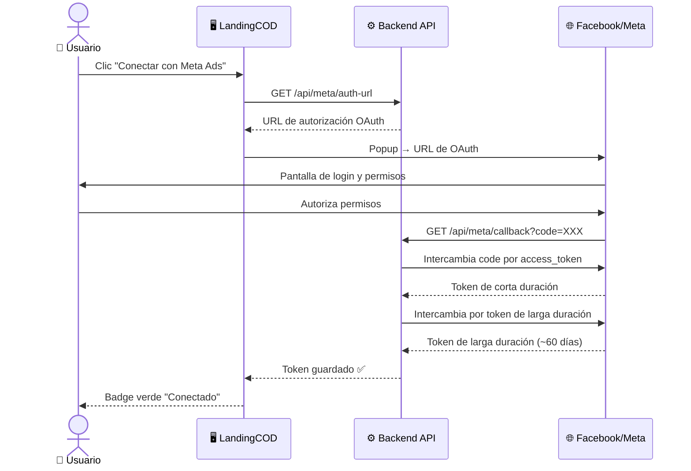
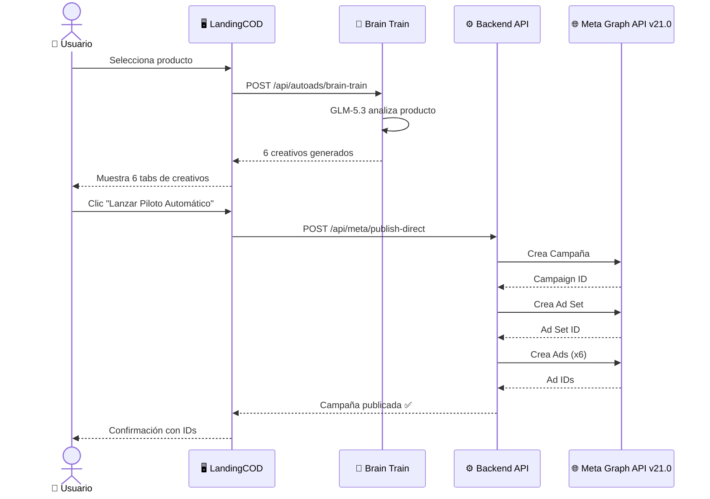

# 🚀 Guía Completa de Configuración — Meta Ads en LandingCOD

> **Plataforma:** LandingCOD (Noelux)  
> **Versión API:** Meta Graph API v21.0  
> **Última actualización:** Noviembre 2026  
> **Autor:** Equipo LandingCOD

---

## 📑 Tabla de Contenidos

1. [Requisitos Previos](#1--requisitos-previos)
2. [Configuración en Meta Developers](#2--configuración-en-meta-developers-developersfaboreckbookcom)
3. [Configuración de Variables de Entorno en Railway](#3--configuración-de-variables-de-entorno-en-railway)
4. [Conectar tu Cuenta Meta Ads desde la App](#4--conectar-tu-cuenta-meta-ads-desde-la-app)
5. [Probar el Flujo Completo](#5--probar-el-flujo-completo)
6. [Pasar la App a Modo Activo (Producción)](#6--pasar-la-app-a-modo-activo-producción)
7. [Solución de Problemas Comunes](#7--solución-de-problemas-comunes)
8. [Arquitectura Técnica (Diagrama de Flujo)](#8--arquitectura-técnica-diagrama-de-flujo)
9. [Referencia de API](#9--referencia-de-api)
10. [Checklist Final](#10--checklist-final)

---

## 1. 📋 Requisitos Previos

Antes de comenzar la configuración, asegurate de contar con **todos** los siguientes elementos:

| # | Requisito | Detalle | Estado |
|---|-----------|---------|--------|
| 1 | **Cuenta de Facebook personal** | Con permisos de administrador en el Business Portfolio | ⬜ |
| 2 | **Business Portfolio** | Nombre: **Landingcod** | ⬜ |
| 3 | **Cuenta publicitaria activa** | Asociada al Business Portfolio con método de pago configurado | ⬜ |
| 4 | **Página de Facebook** | Al menos una página asociada al negocio | ⬜ |
| 5 | **App de Meta Developers** | App ID: `1465256781554439` — Nombre: **LandingCOD** | ⬜ |
| 6 | **Dominio verificado** | `autoads360.up.railway.app` — verificado en Meta Business | ⬜ |
| 7 | **Acceso al Dashboard de Railway** | Para configurar variables de entorno del deploy | ⬜ |
| 8 | **Repositorio GitHub** | `https://github.com/RichardAlmiron/david.git` (branch `main`) | ⬜ |

> [!IMPORTANT]
> **Usuario administrador actual:**  
> 👤 **Richard Santiago Almiron Delgado (Youl)**  
> 📧 `alterocuatro@gmail.com`  
> 🔑 Acceso total (admin)  
> 
> Este usuario tiene permisos completos sobre la app, el Business Portfolio y las cuentas publicitarias.

### 🔧 Datos de la Aplicación

```
App Name:     LandingCOD
App ID:       1465256781554439
App Secret:   547f5fac6512fa43d4af4ec428e56fc5
Categoría:    Negocios y páginas
Modo actual:  Desarrollo (Activo)
Privacy URL:  https://autoads360.up.railway.app/privacy
```

### 🌐 URLs del Proyecto

| Entorno | URL |
|---------|-----|
| 🟢 **Producción** | `https://autoads360.up.railway.app` |
| 🟡 **Desarrollo** | `http://localhost:3000` |
| 📦 **Repositorio** | `https://github.com/RichardAlmiron/david.git` |
| 🚂 **Deploy** | Railway — auto-deploy desde branch `main` |

---

## 2. ⚙️ Configuración en Meta Developers (developers.facebook.com)

### 2.1 🔑 Acceder al Panel de la App

1. Abrí tu navegador e ingresá a **[Meta for Developers](https://developers.facebook.com)**
2. Iniciá sesión con la cuenta de Facebook del administrador (`alterocuatro@gmail.com`)
3. En el menú superior, hacé clic en **"Mis apps"**
4. Buscá y seleccioná la app **LandingCOD** (App ID: `1465256781554439`)
5. Vas a ver el **Dashboard principal** de la app

> [!TIP]
> 🔗 Acceso directo al panel de tu app:  
> `https://developers.facebook.com/apps/1465256781554439/dashboard/`

Una vez dentro del dashboard, verificá que veas la siguiente información:

```
┌──────────────────────────────────────────────┐
│  LandingCOD                                  │
│  App ID: 1465256781554439                    │
│  Estado: En desarrollo                       │
│  Categoría: Negocios y páginas               │
└──────────────────────────────────────────────┘
```

---

### 2.2 📲 Agregar Producto: Facebook Login

El producto **Inicio de sesión con Facebook (Facebook Login)** permite que los usuarios autoricen a la app para acceder a sus cuentas publicitarias y páginas.

**Pasos para agregarlo:**

1. En el menú lateral izquierdo, hacé clic en **"Agregar producto"** (o "Add Product")
2. Buscá **"Inicio de sesión con Facebook"** (Facebook Login)
3. Hacé clic en el botón **"Configurar"** (Set Up)
4. Seleccioná la plataforma **"Web"**
5. En el campo "URL del sitio", ingresá:
   ```
   https://autoads360.up.railway.app
   ```
6. Hacé clic en **"Guardar"** y luego en **"Continuar"**
7. Podés omitir los pasos del asistente (SDK, etc.) ya que la app usa OAuth directo

> [!NOTE]
> Si el producto **Facebook Login** ya aparece en el menú lateral bajo "Productos", significa que ya fue agregado previamente. En ese caso, saltá directamente al paso **2.3** para configurar las URIs de redireccionamiento.

---

### 2.3 🔗 Configurar URIs de Redireccionamiento OAuth

Las URIs de redireccionamiento (Redirect URIs) le indican a Facebook a dónde enviar al usuario después de autorizar la app. **Es crítico que estén configuradas exactamente como se muestra abajo.**

**Pasos:**

1. En el menú lateral, hacé clic en **Facebook Login** → **Configuración** (Settings)
2. Buscá el campo **"URIs de redireccionamiento de OAuth válidos"** (Valid OAuth Redirect URIs)
3. Agregá las siguientes dos URIs:

```
https://autoads360.up.railway.app/api/meta/callback
http://localhost:3000/api/meta/callback
```

4. Hacé clic en **"Guardar cambios"** (Save Changes)

> [!CAUTION]
> ⚠️ Las URIs deben coincidir **exactamente** (incluyendo protocolo, dominio, puerto y path). Un solo carácter diferente provocará el error `redirect_uri mismatch` al intentar conectar.

**Verificación visual — Tu configuración debería verse así:**

| # | URI de Redireccionamiento | Entorno |
|---|---------------------------|---------|
| 1 | `https://autoads360.up.railway.app/api/meta/callback` | 🟢 Producción |
| 2 | `http://localhost:3000/api/meta/callback` | 🟡 Desarrollo |

**Configuraciones adicionales recomendadas** en la misma pantalla de Facebook Login:

| Opción | Valor Recomendado |
|--------|-------------------|
| Inicio de sesión del OAuth del cliente | **Sí** |
| Inicio de sesión del OAuth web | **Sí** |
| Forzar autenticación HTTPS | **Sí** (en producción) |
| URI de redireccionamiento de desconexión | *(dejar vacío)* |
| Inicio de sesión del OAuth de navegador integrado | **No** |

---

### 2.4 📊 Agregar Producto: API de Marketing

El producto **API de Marketing (Marketing API)** permite que la app cree y gestione campañas publicitarias en Meta Ads.

**Pasos para agregarlo:**

1. En el menú lateral izquierdo, hacé clic en **"Agregar producto"** (o "Add Product")
2. Buscá **"API de marketing"** (Marketing API)
3. Hacé clic en el botón **"Configurar"** (Set Up)
4. Meta te mostrará la documentación de la API de marketing
5. No necesitás hacer configuración adicional en este paso; solo es necesario que el producto esté **habilitado** en la app

> [!NOTE]
> La API de Marketing requiere que la app tenga los permisos `ads_management` y `ads_read` aprobados. En **modo Desarrollo**, estos permisos funcionan automáticamente para los usuarios con rol en la app. Para **modo Activo** (producción abierta), necesitás pasar por App Review (ver [Sección 6](#6--pasar-la-app-a-modo-activo-producción)).

**Verificación:** Después de agregar ambos productos, tu menú lateral debería mostrar:

```
📱 LandingCOD
├── 📊 Dashboard
├── ⚙️ Configuración
│   ├── Básica
│   └── Avanzada
├── 🔐 Facebook Login
│   └── Configuración
├── 📈 API de Marketing
│   └── Herramientas
└── 👥 Roles
```

---

### 2.5 ✅ Verificar Permisos y Funciones

La app necesita los siguientes **permisos** para funcionar correctamente con el sistema AutoAds:

| # | Permiso | Identificador | Descripción | Uso en AutoAds |
|---|---------|---------------|-------------|----------------|
| 1 | 📢 **Administración de anuncios** | `ads_management` | Crear y gestionar campañas publicitarias | Publicar campañas vía `/api/meta/publish-direct` |
| 2 | 📖 **Lectura de anuncios** | `ads_read` | Leer datos de campañas y métricas | Obtener estado de campañas existentes |
| 3 | 📄 **Listar páginas** | `pages_show_list` | Listar páginas de Facebook del usuario | Mostrar páginas disponibles en la config |
| 4 | 💬 **Engagement de páginas** | `pages_read_engagement` | Leer engagement de las páginas | Asociar página a la campaña |
| 5 | 🏢 **Gestión de negocio** | `business_management` | Gestionar activos del Business Portfolio | Acceder a cuentas publicitarias del negocio |

**Cómo verificar los permisos:**

1. En el menú lateral, andá a **"Revisión de la app"** → **"Permisos y funciones"**
2. Buscá cada uno de los permisos de la tabla anterior
3. Verificá que cada uno tenga el estado correspondiente:
   - ✅ **"Listo para usar"** — Disponible en modo Desarrollo para usuarios con rol
   - 🟡 **"Disponible para prueba"** — Funciona solo para admins/testers
   - ❌ **"No disponible"** — Necesita solicitarse vía App Review

> [!IMPORTANT]
> En **modo Desarrollo**, todos los permisos funcionan automáticamente para los usuarios que tengan un **rol asignado** en la app (Administrador, Desarrollador o Tester). No necesitás App Review mientras solo vos y tu equipo usen la app.

**Para agregar testers/desarrolladores:**

1. Andá a **Roles** → **Roles de la app** en el menú lateral
2. Hacé clic en **"Agregar personas"**
3. Ingresá el nombre o correo de la persona
4. Asignale el rol **"Tester"** o **"Desarrollador"**
5. La persona recibirá una invitación que debe aceptar

---

### 2.6 🔧 Configuración Avanzada (Opcional)

En **Configuración** → **Básica**, verificá que los siguientes campos estén correctamente configurados:

| Campo | Valor |
|-------|-------|
| Nombre de la app | `LandingCOD` |
| Dominio de la app | `autoads360.up.railway.app` |
| URL de la Política de Privacidad | `https://autoads360.up.railway.app/privacy` |
| URL de los Términos del Servicio | *(opcional, recomendable agregar)* |
| Categoría | `Negocios y páginas` |
| Icono de la app | *(cargar logo de LandingCOD)* |

En **Configuración** → **Avanzada**, podés revisar:

| Opción | Recomendación |
|--------|---------------|
| Flujo de eliminación de datos | Configurar URL o proporcionar instrucciones |
| Modo de compilación nativa/de escritorio | Dejar desactivado |
| Dominios del servidor | Agregar `autoads360.up.railway.app` |
| Actualizar la configuración de IP | Solo si usás IP fija en el servidor |

> [!TIP]
> 💡 **Sobre el App Secret:** Nunca compartas el App Secret (`547f5fac6512fa43d4af4ec428e56fc5`) en código público, repositorios abiertos o chats sin encriptar. Este valor debe vivir **exclusivamente** en las variables de entorno de Railway.

---

## 3. 🚂 Configuración de Variables de Entorno en Railway

### 3.1 🖥️ Acceder al Dashboard de Railway

1. Abrí **[Railway](https://railway.app)** en tu navegador
2. Iniciá sesión con tu cuenta (vinculada a GitHub)
3. Seleccioná el proyecto **LandingCOD** desde tu dashboard
4. Hacé clic en el **servicio** (service) donde está deployado el proyecto
5. Andá a la pestaña **"Variables"**

> [!NOTE]
> 🚂 Railway realiza **auto-deploy** desde el branch `main` del repositorio `https://github.com/RichardAlmiron/david.git`. Cada vez que modifiques las variables de entorno, Railway reiniciará automáticamente el servicio para aplicar los cambios.

---

### 3.2 📝 Agregar Variables

Agregá las siguientes variables de entorno en el panel de Variables de Railway. Hacé clic en **"New Variable"** para cada una:

| # | Variable | Valor | Obligatoria | Notas |
|---|----------|-------|:-----------:|-------|
| 1 | `META_APP_ID` | `1465256781554439` | ✅ | App ID de Meta Developers |
| 2 | `META_APP_SECRET` | `547f5fac6512fa43d4af4ec428e56fc5` | ✅ | App Secret — **NO compartir** |
| 3 | `OPENROUTER_API_KEY` | *(ya configurada)* | ✅ | API key para el modelo GLM-5.3 |
| 4 | `META_ACCESS_TOKEN` | *(se auto-guarda)* | 🔄 | Se genera automáticamente tras OAuth |

> [!WARNING]
> ⚠️ **No modifiques `META_ACCESS_TOKEN` manualmente.** Este valor se genera y guarda automáticamente cuando el usuario completa el flujo de OAuth desde la interfaz de AutoAds. Modificarlo manualmente puede causar errores de autenticación.

**Pasos detallados para agregar cada variable:**

1. En la pestaña **Variables** del servicio, hacé clic en **"+ New Variable"**
2. En el campo **Key**, escribí el nombre exacto de la variable (ej: `META_APP_ID`)
3. En el campo **Value**, pegá el valor correspondiente
4. Hacé clic en **"Add"**
5. Repetí para cada variable
6. Hacé clic en **"Deploy"** (o esperá el auto-deploy)

**Ejemplo visual de cómo se ven las variables en Railway:**

```
┌─────────────────────────────────────────────────────────┐
│  📋 Variables de Entorno                                │
├─────────────────────┬───────────────────────────────────┤
│  META_APP_ID        │  1465256781554439                 │
│  META_APP_SECRET    │  ••••••••••••••••••••             │
│  OPENROUTER_API_KEY │  ••••••••••••••••••••             │
│  META_ACCESS_TOKEN  │  (auto-generado después de OAuth) │
└─────────────────────┴───────────────────────────────────┘
```

> [!TIP]
> 💡 Podés usar la opción **"Raw Editor"** de Railway para pegar todas las variables de una vez en formato `KEY=VALUE`:
> ```env
> META_APP_ID=1465256781554439
> META_APP_SECRET=547f5fac6512fa43d4af4ec428e56fc5
> ```

---

## 4. 🔌 Conectar tu Cuenta Meta Ads desde la App

### 4.1 🏠 Abrir AutoAds en el Panel Admin

1. Abrí tu navegador y navegá a:
   ```
   https://autoads360.up.railway.app/#admin
   ```
2. Iniciá sesión en el panel de administración (si es necesario)
3. En el menú lateral o superior, buscá y hacé clic en **"AutoAds"**

> [!NOTE]
> El módulo AutoAds es la herramienta integrada de LandingCOD que permite crear y gestionar campañas publicitarias en Meta Ads usando inteligencia artificial. Desde acá se gestiona toda la conexión y publicación.

---

### 4.2 ⚙️ Abrir Configuración

1. Dentro del módulo AutoAds, buscá el ícono de **engranaje** ⚙️ en la esquina superior derecha
2. Hacé clic en el ícono ⚙️ para abrir el panel de **Configuración**
3. Se va a desplegar un modal o panel lateral con múltiples tabs de configuración

---

### 4.3 📑 Tab "Meta Ads Directo"

1. Dentro del panel de Configuración, hacé clic en la pestaña/tab **"Meta Ads Directo"**
2. En esta sección vas a ver:
   - **Estado de conexión** — Indica si tu cuenta de Meta está conectada o no
   - **Botón "Conectar con Meta Ads"** — Para iniciar el flujo OAuth
   - **Selector de Cuenta Publicitaria** — Aparece después de conectar
   - **Selector de Página de Facebook** — Aparece después de conectar

```
┌──────────────────────────────────────────────┐
│  🔗 Meta Ads Directo                         │
│                                              │
│  Estado: 🔴 No conectado                    │
│                                              │
│  [🔵 Conectar con Meta Ads]                 │
│                                              │
│  Cuenta Publicitaria: (seleccionar...)       │
│  Página de Facebook:  (seleccionar...)       │
└──────────────────────────────────────────────┘
```

---

### 4.4 🔐 Clic en "Conectar con Meta Ads"

Al hacer clic en el botón **"Conectar con Meta Ads"**, se ejecuta el siguiente flujo OAuth:

**Paso a paso del flujo:**

1. **Se abre un popup (ventana emergente)** en tu navegador
   - La app llama al endpoint `GET /api/meta/auth-url` para obtener la URL de autorización
   - El popup se dirige a Facebook/Meta para que inicies sesión y autorices la app

2. **Pantalla de autorización de Facebook**
   - Vas a ver la pantalla de login de Facebook (si no tenés sesión activa)
   - Después, Meta te mostrará los **permisos** que la app solicita:
     - ✅ Administrar tus anuncios
     - ✅ Leer tus anuncios
     - ✅ Ver tu lista de páginas
     - ✅ Leer engagement de tus páginas
     - ✅ Administrar tu negocio
   - Hacé clic en **"Continuar"** para autorizar **todos** los permisos

3. **Redirección al callback**
   - Facebook redirige el popup a `https://autoads360.up.railway.app/api/meta/callback` con un código de autorización
   - El servidor intercambia ese código por un **token de acceso de larga duración** (~60 días)
   - El token se guarda automáticamente como `META_ACCESS_TOKEN`

4. **El popup se cierra automáticamente**
   - La ventana emergente se cierra sola después de guardar el token

5. **Badge verde "Conectado" ✅**
   - En el panel de Configuración, el estado cambia a:
   ```
   Estado: 🟢 Conectado ✅
   ```
   - Los selectores de Cuenta Publicitaria y Página se habilitan automáticamente

> [!WARNING]
> ⚠️ **¿El popup no se abre?** Si tu navegador bloquea la ventana emergente, vas a ver un aviso en la barra de direcciones. Hacé clic en el aviso y seleccioná **"Permitir siempre popups de autoads360.up.railway.app"**. Luego intentá de nuevo.

> [!IMPORTANT]
> 🔑 El token de larga duración tiene una validez de aproximadamente **60 días**. Después de ese período, necesitarás reconectar haciendo clic en **"Conectar con Meta Ads"** nuevamente. La app mostrará un aviso cuando el token esté por expirar.

---

### 4.5 📋 Seleccionar Cuenta Publicitaria y Página

Una vez conectado (badge verde ✅), la app consulta el endpoint `GET /api/meta/status` para obtener las cuentas publicitarias y páginas disponibles.

**Pasos:**

1. **Seleccionar Cuenta Publicitaria:**
   - Hacé clic en el desplegable **"Cuenta Publicitaria"**
   - Seleccioná la cuenta que querés usar para publicar anuncios
   - La cuenta debe tener un **método de pago activo** configurado

2. **Seleccionar Página de Facebook:**
   - Hacé clic en el desplegable **"Página de Facebook"**
   - Seleccioná la página desde la cual se publicarán los anuncios
   - Los anuncios aparecerán como publicaciones de esta página

3. **Guardar la configuración**
   - Hacé clic en **"Guardar"** para almacenar la selección

```
┌──────────────────────────────────────────────┐
│  🔗 Meta Ads Directo                         │
│                                              │
│  Estado: 🟢 Conectado ✅                    │
│                                              │
│  Cuenta Publicitaria:                        │
│  ┌────────────────────────────────────────┐  │
│  │ ▼ act_123456789 - Mi Negocio          │  │
│  └────────────────────────────────────────┘  │
│                                              │
│  Página de Facebook:                         │
│  ┌────────────────────────────────────────┐  │
│  │ ▼ Mi Página de Negocio                │  │
│  └────────────────────────────────────────┘  │
│                                              │
│  [💾 Guardar]                               │
└──────────────────────────────────────────────┘
```

> [!CAUTION]
> ⚠️ **Cuenta publicitaria sin método de pago:** Si la cuenta publicitaria seleccionada no tiene un método de pago válido configurado, las campañas se crearán pero **no se entregarán**. Meta pausará automáticamente los anuncios hasta que se agregue un método de pago. Configurá el método de pago en [Meta Business Suite](https://business.facebook.com/settings/payment-methods).

---

## 5. 🧪 Probar el Flujo Completo

Una vez configurada la conexión con Meta Ads, es momento de probar todo el flujo de creación de campañas.

### 5.1 🛍️ Seleccionar un Producto

1. Volvé a la vista principal de **AutoAds**
2. Vas a ver la lista de productos disponibles en tu tienda LandingCOD
3. Seleccioná el **producto** para el cual querés crear una campaña publicitaria
4. Hacé clic en el producto para abrir sus opciones de publicidad

> [!TIP]
> 💡 **Recomendación:** Para la primera prueba, elegí un producto con buena imagen, descripción detallada y precio competitivo. Esto ayuda a que la IA genere mejores creativos publicitarios.

---

### 5.2 🧠 Entrenamiento del Cerebro Maestro IA

Al iniciar la creación de una campaña, el sistema activa el **Cerebro Maestro IA** (endpoint `POST /api/autoads/brain-train`), que utiliza el modelo **`openai/gpt-4o-mini`** a través de OpenRouter para redacción ultra-rápida en ~1.6s, junto con **`openai/gpt-image-2.6`** para generación visual y **`minimax/minimax-m3.1-flash`** para dirección de video reels.

**Animación de 3 pasos:**

El proceso muestra una animación visual con 3 etapas:

```
┌──────────────────────────────────────────────────────────┐
│                                                          │
│  🧠 Entrenando Cerebro Maestro IA...                    │
│                                                          │
│  Paso 1/3: 📊 Analizando producto y mercado...    ✅    │
│  ████████████████████████████████████████ 100%           │
│                                                          │
│  Paso 2/3: 🎨 Generando creativos publicitarios... ⏳   │
│  ██████████████████░░░░░░░░░░░░░░░░░░░░  45%            │
│                                                          │
│  Paso 3/3: 📝 Optimizando copy y segmentación...  ⬜    │
│  ░░░░░░░░░░░░░░░░░░░░░░░░░░░░░░░░░░░░░░  0%            │
│                                                          │
└──────────────────────────────────────────────────────────┘
```

| Paso | Descripción | Qué hace |
|------|-------------|----------|
| **Paso 1** | 📊 Analizando producto y mercado | La IA analiza nombre, descripción, precio, imágenes del producto y contexto del mercado |
| **Paso 2** | 🎨 Generando creativos publicitarios | Genera **6 variantes creativas** de anuncios con diferentes enfoques y copies |
| **Paso 3** | 📝 Optimizando copy y segmentación | Refina los textos, define la audiencia objetivo y optimiza los parámetros de la campaña |

> [!NOTE]
> 🕐 El proceso de entrenamiento toma entre **15 y 45 segundos** dependiendo de la complejidad del producto. No cierres la ventana ni recargues la página durante el proceso.

---

### 5.3 📑 Revisar Creativos Generados (6 Tabs)

Una vez finalizado el entrenamiento, el sistema presenta **6 creativos publicitarios** organizados en tabs/pestañas. Cada creativo es una variante diferente del anuncio.

```
┌──────────────────────────────────────────────────────────┐
│                                                          │
│  [Tab 1] [Tab 2] [Tab 3] [Tab 4] [Tab 5] [Tab 6]       │
│                                                          │
│  ┌────────────────────────────────────────────────────┐  │
│  │  📸 Imagen del Anuncio                             │  │
│  │  ┌──────────────────────────────────┐              │  │
│  │  │                                  │              │  │
│  │  │       [Preview del anuncio]      │              │  │
│  │  │                                  │              │  │
│  │  └──────────────────────────────────┘              │  │
│  │                                                    │  │
│  │  📝 Texto principal:                               │  │
│  │  "¡Transformá tu día con [Producto]! ..."          │  │
│  │                                                    │  │
│  │  📌 Título: "Oferta Exclusiva - [Producto]"        │  │
│  │  📋 Descripción: "Envío gratis..."                 │  │
│  │  🔗 CTA: "Comprar ahora"                          │  │
│  └────────────────────────────────────────────────────┘  │
│                                                          │
│              [🚀 Lanzar Piloto Automático]               │
│                                                          │
└──────────────────────────────────────────────────────────┘
```

**Cada tab incluye:**

| Elemento | Descripción |
|----------|-------------|
| 📸 **Imagen** | Preview visual del anuncio |
| 📝 **Texto principal** (Primary Text) | Copy principal del anuncio (body) |
| 📌 **Título** (Headline) | Título corto y atractivo |
| 📋 **Descripción** (Description) | Descripción complementaria |
| 🔗 **Call to Action** (CTA) | Botón de acción (ej: "Comprar ahora", "Ver más") |

> [!TIP]
> 💡 Revisá los 6 creativos antes de lanzar. Podés elegir cuáles activar y cuáles no. La IA genera variaciones con diferentes enfoques (urgencia, beneficio, emoción, social proof, etc.) para que Meta optimice la entrega automáticamente con A/B testing.

---

### 5.4 🚀 Lanzar Piloto Automático

Cuando estés conforme con los creativos generados, hacé clic en el botón **"🚀 Lanzar Piloto Automático"**.

**¿Qué pasa al hacer clic?**

1. **Validación previa:**
   - El sistema verifica que la conexión con Meta esté activa (token válido)
   - Confirma que hay una cuenta publicitaria y página seleccionadas
   - Valida que los creativos estén completos

2. **Llamada al endpoint `POST /api/meta/publish-direct`:**
   - Se envía la solicitud a Meta Graph API v21.0
   - Se crea la **Campaña** (Campaign) con objetivo de conversión
   - Se crea el **Conjunto de anuncios** (Ad Set) con la segmentación definida por la IA
   - Se crean los **Anuncios** (Ads) con los creativos seleccionados

3. **Confirmación visual:**
   ```
   ┌──────────────────────────────────────────┐
   │                                          │
   │  ✅ ¡Campaña publicada exitosamente!     │
   │                                          │
   │  📊 Campaign ID: 120345678901234         │
   │  📋 Ad Set ID:   120345678905678         │
   │  📢 Ads creados: 6                       │
   │                                          │
   │  Estado: En revisión por Meta            │
   │                                          │
   │  [Ver en Meta Ads Manager →]             │
   │                                          │
   └──────────────────────────────────────────┘
   ```

4. **Revisión por Meta:**
   - Meta revisa automáticamente los anuncios (tarda entre minutos y unas pocas horas)
   - Una vez aprobados, los anuncios comienzan a entregarse
   - Podés ver el estado en [Meta Ads Manager](https://adsmanager.facebook.com)

> [!WARNING]
> ⚠️ **Sobre el gasto publicitario:** Al lanzar la campaña, Meta comenzará a cobrar según el presupuesto definido una vez que los anuncios sean aprobados. Asegurate de tener un **método de pago válido** y de estar de acuerdo con el **presupuesto diario** configurado antes de lanzar.

---

## 6. 🏭 Pasar la App a Modo Activo (Producción)

> [!IMPORTANT]
> 📢 **Estado actual de la app: Modo Desarrollo (Activo)**
> 
> En modo Desarrollo, la app **solo funciona para usuarios que tengan un rol asignado** en la app de Meta (Administrador, Desarrollador o Tester). Cualquier otro usuario que intente conectar recibirá un error.

### ¿Cuándo necesitás pasar a Modo Activo?

- Cuando quieras que **otros usuarios** (que no son admins/testers) puedan conectar sus propias cuentas de Meta Ads
- Cuando quieras **distribuir** la app a clientes o terceros

### Requisitos para Modo Activo

Para pasar la app a Modo Activo (Live), necesitás completar los siguientes pasos:

| # | Requisito | Descripción | Estado |
|---|-----------|-------------|--------|
| 1 | **Verificación del negocio** | Verificar tu negocio en Meta Business Settings proporcionando documentación legal | ⬜ |
| 2 | **Política de privacidad** | URL pública accesible: `https://autoads360.up.railway.app/privacy` | ✅ |
| 3 | **App Review** | Solicitar revisión de la app por parte de Meta | ⬜ |
| 4 | **Revisión de permisos** | Aprobar cada permiso individualmente con caso de uso | ⬜ |

### Permisos que requieren App Review

| Permiso | Tipo de Revisión | Qué presentar |
|---------|-----------------|---------------|
| `ads_management` | App Review obligatorio | Video del flujo mostrando cómo se crean campañas |
| `ads_read` | App Review obligatorio | Explicación de por qué se necesitan leer datos de anuncios |
| `pages_show_list` | App Review obligatorio | Explicación del caso de uso con páginas |
| `pages_read_engagement` | App Review obligatorio | Demostración de cómo se usa el engagement |
| `business_management` | App Review obligatorio + Verificación de negocio | Caso de uso detallado del manejo de activos de negocio |

### Pasos para solicitar App Review

1. Andá a **Revisión de la app** → **Solicitudes** en el panel de Meta Developers
2. Seleccioná los permisos que necesitás
3. Para cada permiso, proporcioná:
   - **Descripción detallada** del caso de uso
   - **Screencast/video** mostrando cómo se usa la función en la app
   - **Instrucciones paso a paso** para que el revisor de Meta pueda probar
4. Enviá la solicitud y esperá la revisión (puede tomar de **1 a 5 días hábiles**)

> [!TIP]
> 💡 **Si solo vos (y tu equipo) van a usar la app**, no necesitás pasar a Modo Activo. Simplemente agregá a las personas como **Testers** en **Roles** → **Roles de la app** y la app funcionará perfectamente en modo Desarrollo.

---

## 7. 🔧 Solución de Problemas Comunes

| # | ❌ Problema | ✅ Solución |
|---|------------|-----------|
| 1 | **"Error: redirect_uri mismatch"** | Verificá que las URIs en Facebook Login → Configuración coincidan **exactamente** con `https://autoads360.up.railway.app/api/meta/callback` y `http://localhost:3000/api/meta/callback`. Sin espacios, sin barras finales. |
| 2 | **"Token expirado"** o **"Invalid access token"** | El token de larga duración expiró (~60 días). Andá a ⚙️ → Tab "Meta Ads Directo" → Hacé clic en **"Conectar con Meta Ads"** para reconectar y generar un nuevo token. |
| 3 | **"No se encontraron cuentas publicitarias"** | Verificá que tu cuenta de Facebook tenga al menos una cuenta publicitaria asociada y que hayas otorgado los permisos `ads_management` y `business_management` durante el flujo OAuth. |
| 4 | **"Error al crear campaña"** | Verificá que: (1) la cuenta publicitaria esté **activa** (no deshabilitada/pausada), (2) tenga un **método de pago** válido, y (3) no esté en estado de **revisión** o **restricción** por parte de Meta. |
| 5 | **"Popup bloqueado"** | Tu navegador bloqueó la ventana emergente del OAuth. Hacé clic en el ícono de popup bloqueado en la barra de direcciones y seleccioná **"Permitir siempre popups de autoads360.up.railway.app"**. Luego intentá de nuevo. |
| 6 | **"Error 403: App not authorized"** | Tu usuario no tiene un **rol asignado** en la app de Meta (recuerda: en modo Desarrollo solo funcionan admins/testers). Pedí al admin que te agregue como Tester desde Roles → Roles de la app. |
| 7 | **"Error de permisos insuficientes"** | Durante el flujo OAuth, asegurate de **aceptar todos los permisos** que la app solicita. Si omitiste alguno, desconectá y volvé a conectar aceptando todo. |
| 8 | **El callback no responde** | Verificá que el servicio en Railway esté **corriendo** y que las variables `META_APP_ID` y `META_APP_SECRET` estén configuradas correctamente. Revisá los logs en Railway. |
| 9 | **"Error: Application request limit reached"** | Estás haciendo demasiadas solicitudes a la API de Meta. Esperá unos minutos y reintentá. Meta impone límites de tasa (rate limits) por app. |
| 10 | **Los anuncios no se entregan** | Verificá en [Meta Ads Manager](https://adsmanager.facebook.com) si los anuncios están en estado "En revisión", "Rechazados" o si la cuenta publicitaria tiene problemas de facturación. |
| 11 | **"GraphMethodException: Unsupported post request"** | Verificá que la versión de la API esté correcta (v21.0) y que los parámetros enviados al endpoint sean válidos según la documentación de Meta. |
| 12 | **El entrenamiento IA falla** | Verificá que la variable `OPENROUTER_API_KEY` esté configurada correctamente en Railway y que tu cuenta de OpenRouter tenga créditos disponibles. |
| 13 | **"Error en OpenRouter / Trabajo Pausado"** | Si la API Key vence, carece de saldo o se interrumpe la red, la app despliega el pop-up modal `ApiErrorModal` mostrando el error exacto y pausando el trabajo. No se generan textos ficticios ni fallbacks estáticos. |
| 14 | **"Logs de OpenRouter muestran localhost:3000"** | El servidor resuelve el encabezado `HTTP-Referer` en tiempo real (`getOpenRouterReferer`), registrando la URL exacta de producción (`https://autoads360.up.railway.app`) en las métricas de OpenRouter. |

> [!TIP]
> 💡 **Consejo general de depuración:** Abrí la **Consola del navegador** (F12 → Console) y los **Logs de Railway** para obtener mensajes de error detallados. La mayoría de los errores incluyen un código y mensaje descriptivo de Meta Graph API.

---

## 8. 🏗️ Arquitectura Técnica (Diagrama de Flujo)

### Flujo completo del sistema AutoAds

```mermaid
flowchart TD
    A["👤 Usuario abre AutoAds"] --> B["⚙️ Clic en Configuración"]
    B --> C["📑 Tab Meta Ads Directo"]
    C --> D["🔵 Clic en Conectar con Meta Ads"]
    
    D --> E["🌐 GET /api/meta/auth-url"]
    E --> F["📤 Genera URL de OAuth"]
    F --> G["🪟 Popup: Facebook OAuth Login"]
    G --> H["✅ Usuario autoriza permisos"]
    
    H --> I["🔄 GET /api/meta/callback"]
    I --> J["🔑 Intercambia código por token de larga duración"]
    J --> K["💾 Token guardado como META_ACCESS_TOKEN"]
    K --> L["🪟 Popup se cierra automáticamente"]
    
    L --> M["📊 GET /api/meta/status"]
    M --> N["📋 Lista cuentas publicitarias y páginas"]
    N --> O["👤 Usuario selecciona cuenta y página"]
    
    O --> P["🛍️ Selecciona producto para anunciar"]
    P --> Q["🧠 POST /api/autoads/brain-train"]
    Q --> R["🤖 GLM-5.3 analiza producto y mercado"]
    R --> S["🎨 Genera 6 creativos publicitarios"]
    
    S --> T["📑 Usuario revisa los 6 tabs de creativos"]
    T --> U["🚀 Clic en Lanzar Piloto Automático"]
    
    U --> V["📤 POST /api/meta/publish-direct"]
    V --> W["🌐 Meta Graph API v21.0"]
    W --> X["📊 Crea Campaña + Ad Set + Ads"]
    X --> Y["✅ Campaña publicada en Meta Ads"]
    
    Y --> Z["👀 Verificar en Meta Ads Manager"]
```



### Flujo simplificado de autenticación OAuth



### Flujo de publicación de campaña



---

## 9. 📚 Referencia de API

### Endpoints del Sistema AutoAds

| # | Método | Endpoint | Descripción |
|---|--------|----------|-------------|
| 1 | `GET` | `/api/meta/auth-url` | Genera la URL de OAuth para login con Facebook |
| 2 | `GET` | `/api/meta/callback` | Callback de OAuth — intercambia código por token |
| 3 | `GET` | `/api/meta/status` | Estado de conexión, lista cuentas y páginas |
| 4 | `POST` | `/api/meta/publish-direct` | Publica campaña directamente en Meta Ads |
| 5 | `POST` | `/api/autoads/brain-train` | Entrena el Cerebro Maestro IA con GLM-5.3 |

---

### Detalle de cada endpoint

#### 1. `GET /api/meta/auth-url` — Generar URL de OAuth

Genera la URL de autorización de Facebook para iniciar el flujo OAuth.

**Request:**
```http
GET /api/meta/auth-url HTTP/1.1
Host: autoads360.up.railway.app
```

**Ejemplo de respuesta exitosa:**
```json
{
  "success": true,
  "authUrl": "https://www.facebook.com/v21.0/dialog/oauth?client_id=1465256781554439&redirect_uri=https://autoads360.up.railway.app/api/meta/callback&scope=ads_management,ads_read,pages_show_list,pages_read_engagement,business_management&response_type=code"
}
```

| Campo | Tipo | Descripción |
|-------|------|-------------|
| `success` | `boolean` | Indica si se generó la URL correctamente |
| `authUrl` | `string` | URL completa para redirigir al usuario a Facebook OAuth |

---

#### 2. `GET /api/meta/callback` — Callback de OAuth

Recibe el código de autorización de Facebook, lo intercambia por un token de acceso de larga duración y lo guarda.

**Request (automático desde Facebook):**
```http
GET /api/meta/callback?code=AQB...xyz HTTP/1.1
Host: autoads360.up.railway.app
```

**Parámetros de query:**

| Parámetro | Tipo | Descripción |
|-----------|------|-------------|
| `code` | `string` | Código de autorización de Facebook |

**Ejemplo de respuesta exitosa:**
```json
{
  "success": true,
  "message": "Token de acceso guardado exitosamente",
  "expiresIn": "5184000"
}
```

| Campo | Tipo | Descripción |
|-------|------|-------------|
| `success` | `boolean` | Indica si el token se guardó correctamente |
| `message` | `string` | Mensaje descriptivo |
| `expiresIn` | `string` | Tiempo de expiración del token en segundos (~60 días) |

---

#### 3. `GET /api/meta/status` — Estado de Conexión

Devuelve el estado actual de la conexión con Meta, incluyendo la lista de cuentas publicitarias y páginas de Facebook disponibles.

**Request:**
```http
GET /api/meta/status HTTP/1.1
Host: autoads360.up.railway.app
```

**Ejemplo de respuesta exitosa:**
```json
{
  "success": true,
  "connected": true,
  "user": {
    "id": "123456789",
    "name": "Richard Santiago Almiron Delgado"
  },
  "adAccounts": [
    {
      "id": "act_123456789",
      "name": "Mi Cuenta Publicitaria",
      "currency": "USD",
      "status": "ACTIVE"
    }
  ],
  "pages": [
    {
      "id": "987654321",
      "name": "Mi Página de Negocio",
      "category": "E-commerce website"
    }
  ]
}
```

| Campo | Tipo | Descripción |
|-------|------|-------------|
| `connected` | `boolean` | `true` si hay un token válido guardado |
| `user` | `object` | Datos del usuario de Facebook conectado |
| `adAccounts` | `array` | Lista de cuentas publicitarias disponibles |
| `pages` | `array` | Lista de páginas de Facebook del usuario |

---

#### 4. `POST /api/meta/publish-direct` — Publicar Campaña

Crea y publica una campaña completa en Meta Ads (Campaña + Ad Set + Anuncios).

**Request:**
```http
POST /api/meta/publish-direct HTTP/1.1
Host: autoads360.up.railway.app
Content-Type: application/json
```

```json
{
  "adAccountId": "act_123456789",
  "pageId": "987654321",
  "productName": "Producto Ejemplo",
  "creatives": [
    {
      "headline": "Oferta Exclusiva",
      "primaryText": "¡Transformá tu día con este producto increíble!",
      "description": "Envío gratis a todo el país",
      "callToAction": "SHOP_NOW",
      "imageUrl": "https://autoads360.up.railway.app/images/producto.jpg"
    }
  ],
  "budget": {
    "daily": 1000,
    "currency": "USD"
  },
  "targeting": {
    "ageMin": 18,
    "ageMax": 65,
    "genders": [1, 2],
    "countries": ["PY"]
  }
}
```

**Ejemplo de respuesta exitosa:**
```json
{
  "success": true,
  "campaign": {
    "id": "120345678901234",
    "name": "AutoAds - Producto Ejemplo",
    "status": "ACTIVE"
  },
  "adSet": {
    "id": "120345678905678",
    "name": "AutoAds AdSet - Producto Ejemplo"
  },
  "ads": [
    {
      "id": "120345678909012",
      "name": "Creativo 1 - Oferta Exclusiva",
      "status": "PENDING_REVIEW"
    }
  ],
  "totalAdsCreated": 6
}
```

| Campo | Tipo | Descripción |
|-------|------|-------------|
| `campaign` | `object` | Datos de la campaña creada (ID, nombre, estado) |
| `adSet` | `object` | Datos del conjunto de anuncios creado |
| `ads` | `array` | Lista de anuncios creados con sus IDs |
| `totalAdsCreated` | `number` | Cantidad total de anuncios creados |

---

#### 5. `POST /api/autoads/brain-train` — Entrenar Cerebro Maestro IA

Envía los datos del producto al modelo `openai/gpt-4o-mini` (OpenRouter) para generar creativos publicitarios optimizados de forma ultra-rápida.

**Request:**
```http
POST /api/autoads/brain-train HTTP/1.1
Host: autoads360.up.railway.app
Content-Type: application/json
```

```json
{
  "productName": "Producto Ejemplo",
  "productDescription": "Descripción detallada del producto...",
  "productPrice": 29.99,
  "productImage": "https://autoads360.up.railway.app/images/producto.jpg",
  "targetMarket": "Paraguay",
  "language": "es"
}
```

**Ejemplo de respuesta exitosa:**
```json
{
  "success": true,
  "creatives": [
    {
      "tab": 1,
      "headline": "¡Transformá tu Vida Hoy!",
      "primaryText": "Descubrí por qué miles ya eligieron...",
      "description": "Envío gratis + garantía de satisfacción",
      "callToAction": "SHOP_NOW",
      "approach": "urgencia"
    },
    {
      "tab": 2,
      "headline": "El Secreto que Todos Buscan",
      "primaryText": "Lo que nadie te contó sobre...",
      "description": "Oferta por tiempo limitado",
      "callToAction": "LEARN_MORE",
      "approach": "curiosidad"
    }
  ],
  "targeting": {
    "suggestedAgeRange": "25-55",
    "suggestedInterests": ["compras online", "ofertas"],
    "suggestedGenders": "todos"
  },
  "totalCreatives": 6
}
```

| Campo | Tipo | Descripción |
|-------|------|-------------|
| `creatives` | `array` | 6 creativos generados con diferentes enfoques |
| `targeting` | `object` | Sugerencias de segmentación de la IA |
| `totalCreatives` | `number` | Cantidad total de creativos (siempre 6) |

---

## 10. ✅ Checklist Final

Usá esta lista de verificación para confirmar que todo está correctamente configurado antes de lanzar tu primera campaña:

### 🔧 Configuración en Meta Developers

- [ ] App **LandingCOD** creada con App ID `1465256781554439`
- [ ] Producto **Facebook Login** agregado y configurado
- [ ] URI de redireccionamiento de producción: `https://autoads360.up.railway.app/api/meta/callback`
- [ ] URI de redireccionamiento de desarrollo: `http://localhost:3000/api/meta/callback`
- [ ] Producto **API de Marketing** agregado
- [ ] Permisos verificados: `ads_management`, `ads_read`, `pages_show_list`, `pages_read_engagement`, `business_management`
- [ ] Privacy URL configurada: `https://autoads360.up.railway.app/privacy`
- [ ] Dominio de la app configurado: `autoads360.up.railway.app`

### 🚂 Variables de Entorno en Railway

- [ ] `META_APP_ID` = `1465256781554439`
- [ ] `META_APP_SECRET` configurada correctamente
- [ ] `OPENROUTER_API_KEY` configurada correctamente
- [ ] Servicio de Railway corriendo sin errores
- [ ] Auto-deploy desde branch `main` activo

### 🔌 Conexión con Meta Ads

- [ ] Flujo OAuth completado exitosamente (badge verde ✅)
- [ ] `META_ACCESS_TOKEN` generado automáticamente
- [ ] Cuenta publicitaria seleccionada
- [ ] Página de Facebook seleccionada
- [ ] Cuenta publicitaria con método de pago activo

### 🧪 Prueba del Flujo

- [ ] Producto seleccionado para campaña de prueba
- [ ] Cerebro Maestro IA entrenado exitosamente (3 pasos completados)
- [ ] 6 creativos generados y revisados
- [ ] Campaña piloto lanzada exitosamente
- [ ] Campaña visible en Meta Ads Manager

### 🏭 Producción (Opcional)

- [ ] Negocio verificado en Meta Business Settings
- [ ] App Review solicitado para los permisos requeridos
- [ ] App Review aprobado por Meta
- [ ] App cambiada a Modo Activo (Live)

---

## 11. 🛡️ Estructura Oficial Fijada por ID + Descubrimiento Dinámico de Nombres en Vivo (Actualización Noviembre 2026)

### 11.1 Tabla de Identificadores Oficiales Bloqueados en el Sistema

| Activo de Meta | Identificador Fijo Bloqueado | Obtención del Nombre | Estado en el Sistema |
|----------------|------------------------------|----------------------|----------------------|
| **1. Portafolio Comercial (Business)** | `Landingcod` | Fijo (`Landingcod`) | ✅ Activo Principal |
| **2. Cuenta Publicitaria Oficial (termina en `834`)** | `act_1048211497774834` (`1048211497774834`) | **Dinámico en Vivo** vía `GET /v21.0/act_1048211497774834?fields=name,currency` | ✅ Bloqueada como Única Cuenta de Publicación |
| **3. Píxel Oficial de Cuenta 834 (termina en `377`)** | `1276031534651377` | **Dinámico en Vivo** vía `GET /v21.0/act_1048211497774834/adspixels?fields=id,name` y `GET /v21.0/1276031534651377?fields=id,name` | ✅ Bloqueado como Píxel Oficial CAPI + Ads |
| **4. Página Oficial de Facebook (Fanpage)** | `1050835598123904` | `Landingcod Shop` (fijo) | ✅ Bloqueada como Fanpage Oficial |
| **❌ Cuenta Personal Excluida** | `act_424711183775699` (`424711183775699`) | `Richard Almiron` | 🚫 Excluida al 100% + Auto-Pausa de campañas `[META IA]` |

### 11.2 Nuevos Endpoints y Algoritmos de Resiliencia

1. **Descubrimiento Dinámico en Vivo de Nombres Renombrados (`GET /api/meta/status` y `GET /api/meta/callback`)**:
   - Cuando el administrador cambia el nombre de la cuenta publicitaria `act_1048211497774834` (`834`) o el nombre del píxel `1276031534651377` (`377`) dentro de Meta Business Suite, el backend consulta directamente la Graph API v21.0, guarda los nuevos nombres reales en `store_config.json` (`adAccountName`, `pixelName`) y `.env` (`META_AD_ACCOUNT_NAME`, `META_PIXEL_NAME`), y actualiza en vivo la **Tarjeta de Referencia Oficial (`data-testid="meta-official-reference-card"`)** tanto en `AutoAdsView.tsx` como en la pestaña `🎯 Píxel & CAPI` de `AdminView.tsx`.
   - Incluye el botón **`🔄 Actualizar Nombres Reales desde Meta (834 / 377)`** (`data-testid="btn-discover-live-meta-names"`) para refrescar los nombres en 1 clic.
2. **Auto-Restauración de Sesión OAuth tras Redespliegue en Railway (`POST /api/meta/restore-session`)**:
   - El navegador guarda una copia cifrada del token OAuth y los nombres descubiertos en `localStorage` (`autoads_meta_oauth_backup_v1`). Si Railway reinicia el contenedor tras un `git push`, `refreshMetaConnectionStatus()` llama automáticamente a `POST /api/meta/restore-session` y restaura la sesión sin pedir nuevo login.
3. **Persistencia Dual de los 6 Creativos e Imágenes IA (`POST /api/autoads/save-creatives-cache` y `GET /api/autoads/creatives-cache`)**:
   - Cada imagen generada 1 por 1 se almacena como `.png` en `/public/assets/ai-ads/`, como `dataUrl` Base64 en `localStorage` (`autoads_creatives_cache_v3_<productKey>`) y en el servidor (`store_config.json`), evitando cualquier pérdida de imágenes al recargar o autenticar OAuth.
4. **Cola Secuencial Turno por Turno Anti-`HTTP 402 ("in-flight requests settle")`**:
   - Para evitar que OpenRouter bloquee la generación simultánea por reservas de crédito en vuelo (*in-flight credit hold*), el sistema permite generar cada imagen individualmente (`1 por 1`) o mediante la cola automática turno por turno con espera de liquidación de `3.5s` en frontend y backoff automático de `4.5s` en backend.

---

> [!NOTE]
> 📖 **¿Necesitás ayuda adicional?**  
> - 📧 Contacto admin: `alterocuatro@gmail.com`  
> - 📚 Documentación oficial de Meta: [developers.facebook.com/docs](https://developers.facebook.com/docs/)  
> - 📊 Meta Ads Manager: [adsmanager.facebook.com](https://adsmanager.facebook.com)  
> - 🏢 Meta Business Suite: [business.facebook.com](https://business.facebook.com)

---

<p align="center">
  <strong>🚀 LandingCOD — Sistema AutoAds con Inteligencia Artificial</strong><br>
  <em>Creá campañas publicitarias en Meta Ads con un solo clic</em><br><br>
  Desarrollado por el equipo LandingCOD © 2026
</p>

